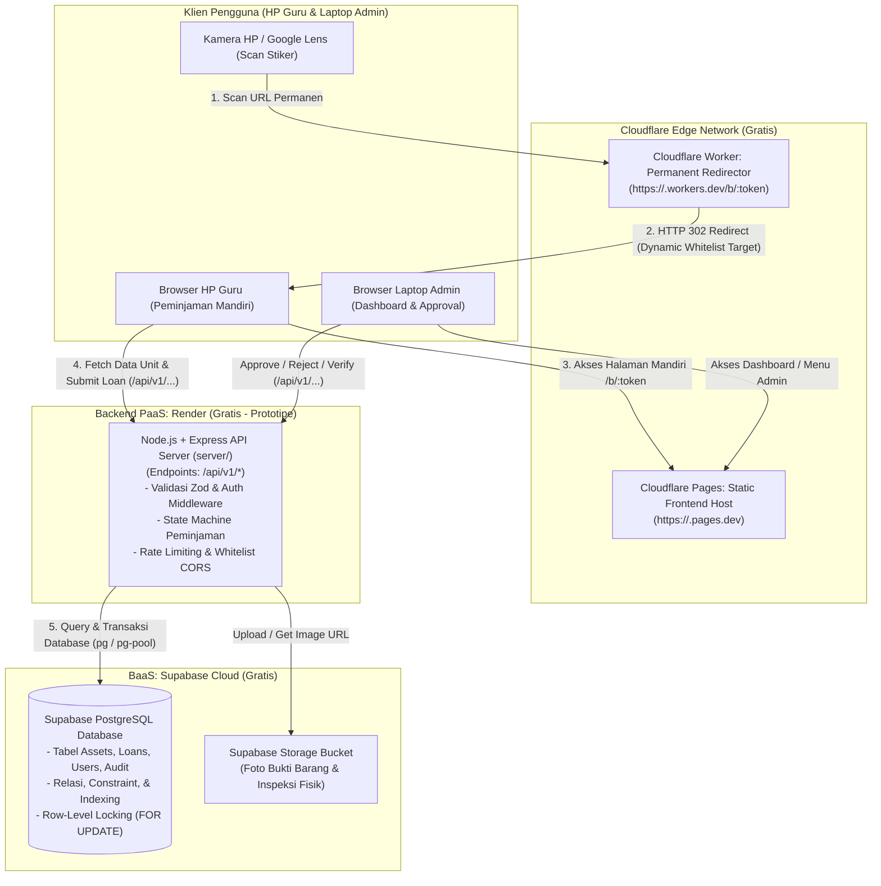
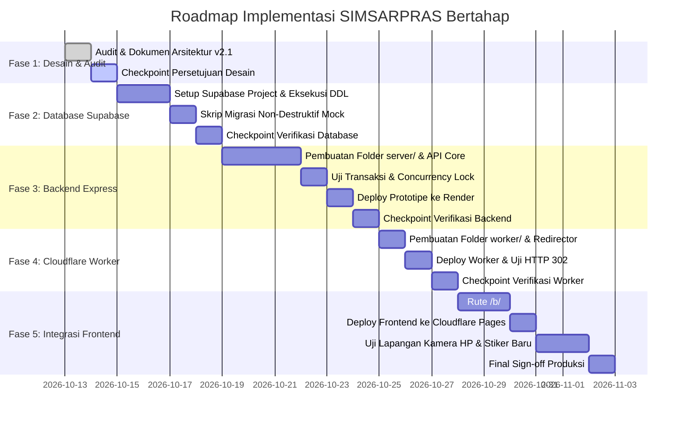

# Arsitektur SIMSARPRAS: Barcode Permanen, Layanan Cloud Gratis, dan Strategi Meminimalkan Cetak Ulang Barcode

> **Dokumen Perancangan Arsitektur Perangkat Lunak (Software Architecture Document)**  
> **Sistem:** SIMSARPRAS — Sistem Informasi Manajemen Sarana dan Prasarana Sekolah  
> **Status:** Usulan Perancangan & Hasil Audit (Revisi Pasca-Review Pemilik Proyek — Tahap Desain)  
> **Versi Dokumen:** 2.1.0  
> **Tanggal Pembaruan:** 13 Oktober 2026  
> **Target Instansi:** RA & MIS Cendikia Bunayya (dapat diskalakan ke multi-sekolah)  

---

## 1. Ringkasan Eksekutif

### 1.1 Latar Belakang dan Masalah
Saat ini, aplikasi SIMSARPRAS berjalan pada lingkungan pengembangan lokal (localhost/PC) dengan barcode stiker fisik yang mengodekan alamat IP lokal Wi-Fi (misalnya `http://192.168.100.45:5173/scan?code=...`). Kondisi ini menimbulkan keterbatasan kritis:
1. **Barcode Mengikat Infrastruktur Fisik Sementara:** Jika PC admin berganti alamat IP, router sekolah di-restart, atau aplikasi dipindahkan ke hosting internet, stiker barcode fisik berpotensi tidak dapat dibuka dari luar jaringan sekolah.
2. **Keterbatasan Akses di Luar Sekolah:** Guru dan pegawai tidak dapat memindai atau mengakses informasi peminjaman barang saat berada di luar jangkauan Wi-Fi lokal sekolah.
3. **Penyimpanan Masih di Sisi Klien:** Data transaksi saat ini masih tersimpan pada media penyimpanan browser lokal (`localStorage`) melalui modul simulasi mock, sehingga data antar-perangkat belum tersinkronisasi ke basis data terpusat.

### 1.2 Sasaran Arsitektur
Arsitektur SIMSARPRAS versi 2.1 dirancang untuk memecahkan masalah di atas dengan prinsip-prinsip:
- **Strategi Meminimalkan Cetak Ulang Barcode:** Pemisahan permanen antara URL yang dicetak pada stiker fisik dan URL hosting aplikasi frontend. Perubahan hosting atau domain di masa depan dilakukan melalui konfigurasi cloud tanpa keharusan mengganti stiker barang, selama alamat pengarah awal tetap aktif.
- **Biaya Infrastruktur Rp 0 (Tahap Prototipe):** Mengoptimalkan kombinasi paket gratis resmi (*free tier*) dari Cloudflare Workers, Cloudflare Pages, Render Web Service, dan Supabase PostgreSQL.
- **Satu Repositori (Monorepo Modular):** Kode frontend, backend Express (`server/`), dan Cloudflare Worker (`worker/`) dikelola dalam satu repositori Git dengan konfigurasi deployment independen untuk masing-masing komponen.
- **Pemisahan Tanggung Jawab (*Separation of Concerns*):** Frontend React statis, Edge Redirector (Worker), Backend API (Express), dan Database (Supabase) terisolasi dengan batas keamanan yang tegas. Kredensial rahasia (*service role keys*, secret JWT) tidak pernah dibocorkan ke sisi klien.
- **Aksesibel Multi-Jaringan:** Dapat diakses melalui browser smartphone via Google Lens atau kamera bawaan, baik melalui Wi-Fi sekolah maupun koneksi seluler/internet luar sekolah, tanpa mewajibkan pemasangan aplikasi native.

---

## 2. Diagram Arsitektur Sistem

Berikut adalah rancangan arsitektur tingkat tinggi SIMSARPRAS:



---

## 3. Diagram Alur Pemindaian Barcode (Sequence Diagram)

Alur penanganan pemindaian barcode dari kamera HP guru hingga pencatatan transaksi di database:

```mermaid
sequenceDiagram
    autonumber
    actor Guru as HP Guru (Google Lens / Kamera)
    participant Worker as Cloudflare Worker (/b/:token)
    participant Pages as Cloudflare Pages (Frontend React)
    participant API as Express API Server (Backend)
    participant DB as Supabase PostgreSQL

    Guru->>Worker: 1. HTTP GET https://<worker>.workers.dev/b/tok_abc123
    Note over Worker: Evaluasi Token & Whitelist Domain Target.<br/>Ambil APP_BASE_URL dari Konfigurasi.
    Worker-->>Guru: 2. HTTP 302 Found (Location: https://<frontend>/b/tok_abc123)
    
    Guru->>Pages: 3. HTTP GET https://<frontend>/b/tok_abc123
    Pages-->>Guru: 4. Kirim Halaman Standalone Peminjaman (Tanpa Menu & Tanpa Login)
    
    Guru->>API: 5. GET /api/v1/public/assets/resolve?token=tok_abc123
    API->>DB: 6. SELECT * FROM assets WHERE qr_token = 'tok_abc123' AND is_decommissioned = false
    DB-->>API: 7. Kembalikan Data Barang (Nama, Lokasi, Status: AVAILABLE)
    API-->>Guru: 8. JSON Data Unit (Aman: Tanpa Secret & Tanpa Data Sensitif)

    Note over Guru: Guru mengisi Nama Peminjam,<br/>Tujuan, & Waktu Kembali di Form 1-Layar.
    Guru->>API: 9. POST /api/v1/public/loans/apply (assetId, borrowerName, purpose, returnAt)
    Note over API: Validasi Ketersediaan Unit & Mode Peminjaman.<br/>Cegah Peminjaman Ganda (Atomic Transaction).
    API->>DB: 10. BEGIN TRANSACTION;<br/>SELECT * FROM assets WHERE id = $1 FOR UPDATE;<br/>UPDATE assets SET operational_status='RESERVED';<br/>INSERT INTO loans ...;<br/>COMMIT;
    DB-->>API: 11. Transaksi Berhasil Disimpan
    API-->>Guru: 12. HTTP 201 Created (Nomor Transaksi PINJAM-2026-xxx)
    Note over Guru: Halaman Menampilkan Bukti Pengajuan Berhasil.
```

---

## 4. Diagram Deployment dan Struktur Repositori Tunggal (Monorepo)

### 4.1 Struktur Folder Proyek
Proyek dikelola dalam satu repositori Git dengan pemisahan direktori yang jelas:

```
SIMSARPRAS/
├── .github/                  # CI/CD Workflows (opsional)
├── docs/                     # Dokumentasi Arsitektur & Panduan
│   └── architecture/
│       └── simsarpras-architecture.md
├── server/                   # BACKEND: Node.js + Express API
│   ├── src/
│   │   ├── config/           # Database & Env Config
│   │   ├── controllers/      # Route Controllers
│   │   ├── middlewares/      # Auth & Error Handling
│   │   ├── routes/           # REST Endpoints (/api/v1/*)
│   │   ├── services/         # State Machine & Business Logic
│   │   └── index.ts          # Server Entrypoint
│   ├── package.json
│   └── tsconfig.json
├── worker/                   # REDIRECTOR: Cloudflare Worker
│   ├── src/
│   │   └── index.ts          # Redirector Handler (/b/:token)
│   ├── wrangler.toml         # Konfigurasi Cloudflare Worker
│   ├── package.json
│   └── tsconfig.json
├── src/                      # FRONTEND: React + Vite (Aplikasi Web Klien)
│   ├── components/
│   ├── pages/
│   ├── services/
│   └── App.tsx
├── public/                   # Asset Statis Frontend
├── index.html
├── package.json              # Dependencies Frontend
├── tsconfig.json
└── vite.config.ts
```

### 4.2 Mekanisme Deployment Independen

| Komponen | Direktori | Platform Hosting | Konfigurasi Deployment Platform |
|---|---|---|---|
| **Frontend Web** | `/` (Root) | Cloudflare Pages | - **Framework Preset:** Vite<br/>- **Build Command:** `npm run build`<br/>- **Build Output Directory:** `dist`<br/>- **Root Directory:** `/` |
| **Backend API** | `server/` | Render Web Service | - **Environment:** Node.js (20 LTS)<br/>- **Root Directory:** `server`<br/>- **Build Command:** `npm install && npm run build`<br/>- **Start Command:** `npm start` |
| **Edge Redirector** | `worker/` | Cloudflare Workers | - **Deployment Tool:** Cloudflare Dashboard / Wrangler CLI (`npx wrangler deploy`)<br/>- **Working Directory:** `worker` |

---

## 5. Tanggung Jawab Setiap Komponen (*Separation of Concerns*)

| Komponen | Lingkungan Hosting | Tanggung Jawab Utama | Hal yang DILARANG Dilakukan |
|---|---|---|---|
| **Label Fisik (Stiker QR)** | Tertempel pada Aset Sekolah | - Memuat kode teks dan QR Code statis.<br/>- Menghubungkan pemindai fisik ke Edge Redirector. | - DILARANG mencetak alamat IP (`192.168.x.x`), `localhost`, atau port dev.<br/>- DILARANG mencetak URL hosting sementara yang mudah berubah. |
| **Cloudflare Worker** | Cloudflare Edge (`*.workers.dev`) | - Bertindak sebagai *Permanent Redirector* berkinerja tinggi (<20ms).<br/>- Memetakan `/b/:token` ke frontend yang aktif.<br/>- Memvalidasi domain tujuan terhadap *whitelist* yang diizinkan.<br/>- Mengembalikan respon HTTP 302. | - DILARANG memproses logika otentikasi login.<br/>- DILARANG melakukan kueri langsung ke database Supabase.<br/>- DILARANG menerima URL redirect sembarang dari parameter pengguna (*anti open redirect*). |
| **Cloudflare Pages** | Cloudflare Pages (`*.pages.dev`) | - Menyajikan antarmuka visual (React SPA).<br/>- Menampilkan halaman peminjaman mandiri ringkas (`/b/:token`) tanpa menu sistem dan tanpa login.<br/>- Menampilkan dashboard internal admin yang terproteksi.<br/>- Mengelola state interaktif klien (TanStack Query, Form). | - DILARANG menyimpan *service-role secret* Supabase atau rahasia backend.<br/>- DILARANG memproses otorisasi mutasi data secara independen tanpa validasi backend. |
| **Express API Server** | Render Web Service | - Memvalidasi seluruh payload masukan menggunakan Zod.<br/>- Menegakkan *State Machine* peminjaman & pengembalian barang.<br/>- Mengatur otentikasi JWT dan otorisasi hak akses (*Role-Based Access Control*).<br/>- Menjalankan transaksi basis data atomik (*ACID transactions*).<br/>- Menuliskan riwayat ke tabel audit log. | - DILARANG menyajikan file HTML statis frontend (pekerjaan ini diserahkan ke Cloudflare Pages).<br/>- DILARANG mengizinkan CORS dari domain asing di luar whitelist. |
| **Supabase PostgreSQL** | Supabase Cloud | - Menyimpan seluruh data master dan transaksional secara persisten.<br/>- Menegakkan integritas referensial (*foreign keys*, *unique constraints*, *check constraints*).<br/>- Mengelola file objek gambar stiker dan bukti fisik. | - DILARANG membuka akses tabel secara publik tanpa pengamanan backend atau kebijakan RLS yang ketat. |

---

## 6. Desain URL Barcode Permanen & Abstraksi Identitas

### 6.1 Pola URL Produksi
URL produksi yang dicetak pada stiker fisik menggunakan format:

$$\text{https://}\langle\text{worker-subdomain}\rangle\text{.workers.dev/b/}\langle\text{token}\rangle$$

*Contoh Representasi (Kandidat):*  
`https://<kandidat-worker>.workers.dev/b/tok_e8f2a1b94c3d`  
*(Catatan: Nama subdomain berstatus kandidat sampai ketersediaannya diverifikasi saat pendaftaran akun Cloudflare).*

### 6.2 Mengapa Memilih HTTP 302 (Bukan HTTP 301)?
- **HTTP 301 (Moved Permanently):** Disimpan (*cached*) secara agresif dan permanen oleh browser smartphone (Chrome, Safari, Google Lens) di penyimpanan lokal HP pengguna. Jika sekolah kemudian memindahkan frontend dari `pages.dev` ke domain resmi `sarpras.sekolah.sch.id`, HP guru yang pernah memindai barcode akan terus berusaha membuka alamat lama dan gagal mengakses sistem.
- **HTTP 302 (Found / Temporary Redirect):** Menginstruksikan browser untuk selalu bertanya ke Cloudflare Worker setiap kali pemindaian dilakukan. Worker mengevaluasi variabel konfigurasi terbaru di edge dan mengarahkan pengguna ke hosting frontend aktif secara instan. Latensi evaluasi Cloudflare Worker di edge sangat rendah (rata-rata 10–25 milidetik), sehingga tidak terasa oleh pengguna.

### 6.3 Pencegahan *Open Redirect* (Keamanan Pengarah)
Cloudflare Worker dilengkapi mekanisme validasi ketat (*strict whitelist*). Worker hanya mengizinkan pengalihan ke daftar domain yang terdaftar dalam variabel konfigurasi:

```typescript
// Blueprint Implementasi Cloudflare Worker (worker/src/index.ts)
export interface Env {
  APP_BASE_URL: string;         // Contoh: "https://<kandidat-pages>.pages.dev"
  ALLOWED_DOMAINS: string;      // Contoh: "sisarpras.pages.dev,sarpras.sekolah.sch.id,localhost:5173"
}

export default {
  async fetch(request: Request, env: Env): Promise<Response> {
    const url = new URL(request.url);
    const pathParts = url.pathname.split('/').filter(Boolean);

    // Validasi Pola URL: /b/:token
    if (pathParts.length !== 2 || pathParts[0] !== 'b') {
      return new Response('Format barcode tidak valid. Format yang benar: /b/<token>', {
        status: 400,
        headers: { 'Content-Type': 'text/plain; charset=utf-8' },
      });
    }

    const token = pathParts[1].trim();
    // Sanitasi Token: hanya izinkan karakter alfanumerik, strip, dan underscore
    if (!/^[a-zA-Z0-9_-]{8,64}$/.test(token)) {
      return new Response('Format token barang tidak valid.', { status: 400 });
    }

    // Validasi Keamanan Domain Tujuan (Cegah Open Redirect)
    const targetBase = env.APP_BASE_URL.replace(/\/+$/, '');
    const targetHost = new URL(targetBase).host.toLowerCase();
    const allowedList = env.ALLOWED_DOMAINS.split(',').map((d) => d.trim().toLowerCase());

    if (!allowedList.includes(targetHost)) {
      return new Response('Domain tujuan redirect belum terdaftar dalam whitelist keamanan.', {
        status: 500,
      });
    }

    // Buat URL Tujuan Baru: mengarahkan ke halaman mandiri frontend (/b/:token)
    const destinationUrl = `${targetBase}/b/${encodeURIComponent(token)}`;

    // Kembalikan HTTP 302 Found
    return Response.redirect(destinationUrl, 302);
  },
};
```

---

## 7. Desain Migrasi `localStorage` ke Supabase, Express API, dan Perlindungan Data

### 7.1 Audit Struktur Data `localStorage` Saat Ini
Berdasarkan audit terhadap file [src/services/mockStorage.ts](file:///c:/Users/Lenovo/Documents/SIMSARPRAS/src/services/mockStorage.ts) dan [src/data/mockData.ts](file:///c:/Users/Lenovo/Documents/SIMSARPRAS/src/data/mockData.ts), data tersimpan pada *key* lokal berikut:

| Key `localStorage` | Entitas Data | Jumlah Record Aktif | Atribut Kunci yang Wajib Dipertahankan |
|---|---|---|---|
| `sisarpras_assets_v1` | Master Data Barang | 10 unit aset | `id`, `assetCode` (contoh: `INV-TIK-2024-001`), `qrToken`, `permanentId`, `operationalStatus`, `conditionStatus` |
| `sisarpras_loans_v1` | Transaksi Peminjaman | 3 transaksi aktif/riwayat | `id`, `loanNumber`, `borrowerId`, `borrowerName`, `status`, `loanModeSnapshot`, `expectedReturnAt` |
| `sisarpras_categories_v1` | Kategori Barang | 4 kategori | `id` (`cat-tik`, `cat-meb`, `cat-olr`, `cat-el`), `defaultLoanMode` |
| `sisarpras_locations_v1` | Ruangan / Lokasi | 7 lokasi | `id`, `code` (`LAB-TIK-1`, `GUD-01`, dll) |
| `sisarpras_users_v1` | Pengguna & Profil | 4 pengguna | `id` (`usr-admin-1`, `usr-guru-1`, dll), `role`, `employeeNumber` |
| `sisarpras_audit_v1` | Log Aktivitas | Riwayat audit | `action`, `entityType`, `entityId`, `details`, `timestamp` |

### 7.2 Strategi Migrasi Non-Destruktif (*Zero Data Loss & Stable Tokens*)
1. **Tidak Ada Penghapusan Data:** Data yang sudah ada di mock data tidak akan dibuang, melainkan diekspor ke format SQL seed yang valid.
2. **Token Barcode Tidak Berubah:** Nilai `qrToken` (contoh: `QR-TIK-ASUS-001`) dan `assetCode` (`INV-TIK-2024-001`) dipertahankan 100% sama agar pengujian dan identitas fisik tetap sinkron.
3. **Skrip Migrasi Idempoten (`server/scripts/seed-from-mock.ts`):**  
   Skrip menggunakan klausa `ON CONFLICT (id) DO NOTHING` atau `ON CONFLICT (asset_code) DO UPDATE` sehingga aman dieksekusi berkali-kali tanpa menghasilkan duplikasi.
4. **Dual-Mode Frontend (*Graceful Fallback*):**  
   Frontend pada [src/services/api.ts](file:///c:/Users/Lenovo/Documents/SIMSARPRAS/src/services/api.ts) mempertahankan variabel `IS_MOCK_MODE`. Jika `VITE_API_BASE_URL` kosong atau server backend sedang offline, frontend secara otomatis beralih ke simulasi lokal sehingga pengembangan lokal tetap berjalan lancar.

### 7.3 Skema Database Relasional (Supabase PostgreSQL DDL)

```sql
-- Ekstensi PostgreSQL
CREATE EXTENSION IF NOT EXISTS "uuid-ossp";

-- 1. ENUMERASI STATUS SISTEM
CREATE TYPE user_role AS ENUM ('ADMIN_SARPRAS', 'GURU_PEGAWAI', 'KEPALA_SEKOLAH');
CREATE TYPE loan_mode AS ENUM ('DIRECT', 'ADMIN_APPROVAL');
CREATE TYPE condition_status AS ENUM ('GOOD', 'MINOR_DAMAGE', 'MAJOR_DAMAGE', 'LOST');
CREATE TYPE operational_status AS ENUM (
    'AVAILABLE',
    'RESERVED',
    'ON_LOAN',
    'RETURN_PENDING',
    'RETURN_INSPECTION',
    'MAINTENANCE',
    'INACTIVE',
    'LOST'
);
CREATE TYPE loan_status AS ENUM (
    'PENDING_APPROVAL',
    'ACTIVE',
    'RETURN_REQUESTED',
    'RETURN_RECEIVED',
    'COMPLETED',
    'REJECTED',
    'CANCELLED'
);

-- 2. TABEL PENGGUNA (USERS & PROFILES)
CREATE TABLE users (
    id UUID PRIMARY KEY DEFAULT uuid_generate_v4(),
    email VARCHAR(255) UNIQUE NOT NULL,
    password_hash VARCHAR(255),
    full_name VARCHAR(255) NOT NULL,
    employee_number VARCHAR(64) DEFAULT '-',
    role user_role NOT NULL DEFAULT 'GURU_PEGAWAI',
    department VARCHAR(128) DEFAULT 'Guru / Pegawai',
    is_active BOOLEAN NOT NULL DEFAULT true,
    created_at TIMESTAMPTZ NOT NULL DEFAULT NOW(),
    updated_at TIMESTAMPTZ NOT NULL DEFAULT NOW()
);

-- 3. TABEL KATEGORI DAN LOKASI
CREATE TABLE categories (
    id VARCHAR(64) PRIMARY KEY,
    name VARCHAR(128) NOT NULL,
    default_loan_mode loan_mode NOT NULL DEFAULT 'DIRECT',
    description TEXT,
    is_active BOOLEAN NOT NULL DEFAULT true,
    created_at TIMESTAMPTZ NOT NULL DEFAULT NOW()
);

CREATE TABLE locations (
    id VARCHAR(64) PRIMARY KEY,
    name VARCHAR(128) NOT NULL,
    code VARCHAR(64) UNIQUE NOT NULL,
    description TEXT,
    is_active BOOLEAN NOT NULL DEFAULT true,
    created_at TIMESTAMPTZ NOT NULL DEFAULT NOW()
);

-- 4. TABEL MASTER ASET (ASSETS)
CREATE TABLE assets (
    id UUID PRIMARY KEY DEFAULT uuid_generate_v4(),
    permanent_id VARCHAR(64) UNIQUE NOT NULL,  -- Identitas permanen independen
    qr_token VARCHAR(64) UNIQUE NOT NULL,      -- Token yang dikodekan pada URL barcode
    asset_code VARCHAR(64) UNIQUE NOT NULL,    -- Kode inventaris (contoh: INV-TIK-2024-001)
    item_name VARCHAR(255) NOT NULL,
    institution VARCHAR(128) NOT NULL DEFAULT 'MIS Cendikia Bunayya',
    category_id VARCHAR(64) REFERENCES categories(id),
    location_id VARCHAR(64) REFERENCES locations(id),
    item_brand VARCHAR(128),
    funding_source VARCHAR(128),
    acquisition_year INT,
    technical_specs TEXT,
    effective_loan_mode loan_mode NOT NULL DEFAULT 'ADMIN_APPROVAL',
    condition_status condition_status NOT NULL DEFAULT 'GOOD',
    operational_status operational_status NOT NULL DEFAULT 'AVAILABLE',
    photo_url TEXT,
    notes TEXT,
    standard_accessories JSONB DEFAULT '[]'::jsonb,
    is_decommissioned BOOLEAN NOT NULL DEFAULT false,
    decommissioned_at TIMESTAMPTZ,
    decommissioned_reason TEXT,
    created_at TIMESTAMPTZ NOT NULL DEFAULT NOW(),
    updated_at TIMESTAMPTZ NOT NULL DEFAULT NOW()
);

CREATE INDEX idx_assets_qr_token ON assets(qr_token);
CREATE INDEX idx_assets_asset_code ON assets(asset_code);
CREATE INDEX idx_assets_operational_status ON assets(operational_status);

-- 5. TABEL TRANSAKSI PEMINJAMAN (LOANS)
CREATE TABLE loans (
    id UUID PRIMARY KEY DEFAULT uuid_generate_v4(),
    loan_number VARCHAR(64) UNIQUE NOT NULL,
    asset_id UUID NOT NULL REFERENCES assets(id) ON DELETE RESTRICT,
    borrower_id UUID REFERENCES users(id),
    borrower_name VARCHAR(255) NOT NULL,
    borrower_employee_number VARCHAR(64) DEFAULT '-',
    borrower_role user_role DEFAULT 'GURU_PEGAWAI',
    status loan_status NOT NULL DEFAULT 'PENDING_APPROVAL',
    loan_mode_snapshot loan_mode NOT NULL,
    purpose TEXT NOT NULL,
    requested_at TIMESTAMPTZ NOT NULL DEFAULT NOW(),
    expected_return_at TIMESTAMPTZ NOT NULL,
    approved_by UUID REFERENCES users(id),
    approved_by_name VARCHAR(255),
    approved_at TIMESTAMPTZ,
    rejection_reason TEXT,
    return_notes TEXT,
    created_at TIMESTAMPTZ NOT NULL DEFAULT NOW(),
    updated_at TIMESTAMPTZ NOT NULL DEFAULT NOW()
);

-- 6. TABEL VERIFIKASI PENGEMBALIAN FISIK (RETURN_INSPECTIONS)
CREATE TABLE return_inspections (
    id UUID PRIMARY KEY DEFAULT uuid_generate_v4(),
    loan_id UUID UNIQUE NOT NULL REFERENCES loans(id) ON DELETE CASCADE,
    received_by UUID NOT NULL REFERENCES users(id),
    received_by_name VARCHAR(255) NOT NULL,
    received_at TIMESTAMPTZ NOT NULL DEFAULT NOW(),
    inspected_by UUID NOT NULL REFERENCES users(id),
    inspected_by_name VARCHAR(255) NOT NULL,
    inspected_at TIMESTAMPTZ NOT NULL DEFAULT NOW(),
    condition_at_return condition_status NOT NULL DEFAULT 'GOOD',
    accessories_complete BOOLEAN NOT NULL DEFAULT true,
    issue_description TEXT,
    notes TEXT,
    resulting_status operational_status NOT NULL DEFAULT 'AVAILABLE',
    created_at TIMESTAMPTZ NOT NULL DEFAULT NOW()
);

-- 7. TABEL AUDIT LOG (IMMUTABLE AUDIT TRAIL)
CREATE TABLE audit_logs (
    id UUID PRIMARY KEY DEFAULT uuid_generate_v4(),
    user_id UUID REFERENCES users(id),
    user_name VARCHAR(255) NOT NULL,
    action VARCHAR(64) NOT NULL,
    entity_type VARCHAR(64) NOT NULL,
    entity_id VARCHAR(128) NOT NULL,
    entity_code VARCHAR(128),
    details TEXT NOT NULL,
    ip_address VARCHAR(64),
    created_at TIMESTAMPTZ NOT NULL DEFAULT NOW()
);
CREATE INDEX idx_audit_created_at ON audit_logs(created_at DESC);
```

### 7.4 Arsitektur Express API dan Proteksi Transaksi

```
Express Server (server/)
├── Public Routes (Tanpa Login):
│   ├── GET  /api/v1/public/assets/resolve?token=:token
│   └── POST /api/v1/public/loans/apply
│   └── POST /api/v1/public/loans/return-request
├── Auth Routes:
│   ├── POST /api/v1/auth/login
│   └── GET  /api/v1/auth/me (Bearer Token)
└── Protected Routes (Role: ADMIN_SARPRAS):
    ├── GET  /api/v1/admin/loans/pending
    ├── POST /api/v1/admin/loans/:id/approve
    ├── POST /api/v1/admin/loans/:id/reject
    ├── POST /api/v1/admin/returns/:id/receive-physical
    ├── POST /api/v1/admin/returns/:id/verify
    └── CRUD /api/v1/admin/assets
```

#### Mekanisme Pencegahan Peminjaman Ganda (*Concurrency Protection*):
Pada backend Express, pengajuan peminjaman dieksekusi menggunakan transaksi database PostgreSQL dengan kunci baris (*row-level lock*):
```typescript
// Blueprint Transaksi Aman di Backend Express
await client.query('BEGIN');
try {
  // 1. Kunci baris aset untuk mencegah race condition
  const assetRes = await client.query(
    'SELECT id, operational_status, effective_loan_mode FROM assets WHERE id = $1 FOR UPDATE',
    [assetId]
  );
  const asset = assetRes.rows[0];

  if (!asset || asset.operational_status !== 'AVAILABLE') {
    throw new Error('Barang sedang tidak tersedia untuk dipinjam.');
  }

  // 2. Tentukan status awal berdasarkan mode
  const initialStatus = asset.effective_loan_mode === 'DIRECT' ? 'ACTIVE' : 'PENDING_APPROVAL';
  const newOperational = asset.effective_loan_mode === 'DIRECT' ? 'ON_LOAN' : 'RESERVED';

  // 3. Update status aset
  await client.query(
    'UPDATE assets SET operational_status = $1, updated_at = NOW() WHERE id = $2',
    [newOperational, assetId]
  );

  // 4. Masukkan data peminjaman
  const loanRes = await client.query(
    `INSERT INTO loans (loan_number, asset_id, borrower_name, status, loan_mode_snapshot, purpose, expected_return_at)
     VALUES ($1, $2, $3, $4, $5, $6, $7) RETURNING *`,
    [loanNumber, assetId, borrowerName, initialStatus, asset.effective_loan_mode, purpose, expectedReturnAt]
  );

  await client.query('COMMIT');
  return loanRes.rows[0];
} catch (err) {
  await client.query('ROLLBACK');
  throw err;
}
```

---

## 8. Strategi Migrasi Barcode Lama

### 8.1 Kebijakan Penggunaan Barcode Lama vs Produksi Baru
Sesuai arahan pemilik proyek:
- **Barcode Lama Berbasis IP Lokal (`http://192.168.100.45:5173/scan?code=...`):**  
  **Dipertahankan sementara untuk penggunaan di jaringan Wi-Fi sekolah.** Guru yang memindai di area sekolah saat dev server PC aktif tetap dapat membuka form barang tanpa hambatan.
- **Barcode Produksi Baru:**  
  Wajib menggunakan URL Cloudflare Worker yang telah diuji (`https://<kandidat-worker>.workers.dev/b/:token`). Seluruh pencetakan stiker baru massal diarahkan ke format Worker ini.

### 8.2 Matriks Klasifikasi Barcode

| Kategori Barcode | Isi Konten Barcode Saat Ini | Dampak Saat Pindah ke Cloud | Tindakan & Rekomendasi |
|---|---|---|---|
| **Tipe A: URL IP Lokal PC** | `http://192.168.100.45:5173/scan?code=...` | Hanya aktif di Wi-Fi sekolah saat PC aktif. | **Pertahankan sementara.** Tidak perlu buru-buru dicabut dari barang selama Wi-Fi sekolah digunakan. |
| **Tipe B: Barcode 1D (Garis)** | Teks kode murni (misal: `INV-TIK-2024-001`) | **Tidak terdampak sama sekali.** Barcode 1D tidak memuat nama domain atau IP. | **Pertahankan 100%.** Scanner fisik USB dan pencarian manual tetap berfungsi normal. |
| **Tipe C: URL Permalink Pendek** | `/q/INV-TIK-2024-001` atau `/q/:token` | Terdampak pada domain awalan jika domain berpindah. | Dipetakan kompatibilitasnya di frontend React melalui rute *backward compatible* `/q/:tokenOrCode`. |
| **Tipe D: Barcode Produksi Baru** | `https://<worker>.workers.dev/b/:token` | **Permanen & Terproteksi.** Tidak terpengaruh perubahan IP, port, atau hosting frontend. | Format standar untuk seluruh pencetakan label stiker ke depan. |

---

## 9. Strategi Meminimalkan Cetak Ulang Barcode

### 9.1 Skenario 1: Frontend Berpindah Hosting (Misal: dari Cloudflare Pages ke Hosting Lain)
1. Buka dashboard Cloudflare Workers.
2. Ubah variabel lingkungan:
   ```env
   APP_BASE_URL="https://frontend-baru-sekolah.com"
   ```
3. Klik **Deploy** (berlangsung dalam 2 detik).
4. **Hasil:** Seluruh stiker barcode di ratusan barang langsung mengarah ke hosting baru tanpa perlu mencetak ulang stiker fisik.

### 9.2 Skenario 2: Sekolah Menggunakan Domain Resmi (Misal: `sarpras.cendikiabunayya.sch.id`)
1. Di Cloudflare Pages: hubungkan Custom Domain `sarpras.cendikiabunayya.sch.id` (SSL otomatis terbit gratis).
2. Di Cloudflare Worker: perbarui variabel `APP_BASE_URL` ke domain resmi tersebut.
3. Di backend Express: perbarui `CORS_ALLOWED_ORIGINS` untuk mengizinkan domain baru.
4. **Hasil:** Pemindaian stiker fisik yang telah beredar tetap mengalir lancar ke domain resmi sekolah.

---

## 10. Environment Variable dan Konfigurasi Sistem

### 10.1 Frontend (Cloudflare Pages)
```env
# URL API Backend Express yang aktif
VITE_API_BASE_URL="https://sisarpras-api.onrender.com/api/v1"

# Identitas Sekolah Default
VITE_APP_NAME="SI-SARPRAS Cendikia Bunayya"
```

### 10.2 Backend (Render Web Service)
```env
# Server Port
PORT=10000
NODE_ENV=production

# Supabase PostgreSQL Connection Pooler (Port 6543, SSL mode require)
DATABASE_URL="postgres://postgres.<project-ref>:[PASSWORD]@aws-0-ap-southeast-1.pooler.supabase.com:6543/postgres?sslmode=require"

# JWT Secret untuk Autentikasi Pengguna
JWT_SECRET="kunci_rahasia_jwt_produksi_simsarpras_cendikia_2026_xyz"
JWT_EXPIRES_IN="7d"

# CORS Whitelist (Domain frontend yang diizinkan berinteraksi dengan API)
CORS_ALLOWED_ORIGINS="https://<kandidat-pages>.pages.dev,https://sarpras.cendikiabunayya.sch.id"

# Rate Limiter Configuration
RATE_LIMIT_WINDOW_MS=900000 # 15 menit
RATE_LIMIT_MAX_REQUESTS=300
```

### 10.3 Cloudflare Worker
```env
# Alamat Frontend Aktif (Tujuan Redirect HTTP 302)
APP_BASE_URL="https://<kandidat-pages>.pages.dev"

# Whitelist Domain Tujuan yang Diizinkan (Pencegahan Open Redirect)
ALLOWED_DOMAINS="sisarpras.pages.dev,sarpras.cendikiabunayya.sch.id,localhost:5173"
```

---

## 11. Analisis Realistis Paket Gratis (*Free Tier*) dan Risiko

### 11.1 Realita Paket Gratis

| Layanan | Komponen | Batasan Paket Gratis | Fakta & Batasan Realistis |
|---|---|---|---|
| **Cloudflare Pages** | Frontend React | Bandwidth tak terbatas, 500 build/bulan | Sangat andal untuk produksi skala sekolah. Biaya: **Rp 0**. |
| **Cloudflare Workers** | Redirector Barcode | 100.000 request/hari, 10ms CPU/req | Rata-rata scan di sekolah 20–200 req/hari (jauh di bawah kuota). Biaya: **Rp 0**. |
| **Render (Prototipe)** | Express API (`server/`) | 750 jam/bulan, RAM 512 MB. **Inactivity Sleep:** Server tidur setelah 15 menit hening. | **Cold start 30–50 detik:** Diterima untuk tahap prototipe. UptimeRobot / ping eksternal adalah alat bantu *best-effort*, **bukan jaminan SLA**. Jika ke depan dibutuhkan respon seketika 24/7, pertimbangkan upgrade paket Render berbayar ($7/bln) atau VPS lokal sekolah. |
| **Supabase** | PostgreSQL DB | 500 MB DB, 1 GB file. **Pause Project:** Proyek di-pause jika 7 hari tanpa aktivitas. | Berpotensi ter-pause saat libur semester panjang sekolah (>7 hari). Admin perlu me-resume di dashboard sebelum tahun ajaran baru. |

---

## 12. Rencana Pengujian dan Kriteria Penerimaan (*Acceptance Criteria*)

1. **Verifikasi Redirect Permanen (Worker Resolution):**  
   Request `GET /b/:token` ke Cloudflare Worker wajib mengembalikan status HTTP 302 dengan header `Location` yang tepat menuju `https://<frontend>/b/:token`.
2. **Kekebalan terhadap Perubahan Hosting Frontend:**  
   Saat nilai variabel `APP_BASE_URL` diubah dari staging ke production, request pemindaian barcode yang sama wajib langsung dialihkan ke URL tujuan baru tanpa mengubah isi barcode.
3. **Pencegahan Open Redirect:**  
   Upaya menyisipkan domain asing berbahaya pada parameter redirect wajib diblokir dan menghasilkan respon HTTP 400/500 dari Worker.
4. **Penanganan Token Barang Tidak Ditemukan:**  
   Pemindaian token yang tidak terdaftar di database menampilkan halaman bersahabat: *"Data Barang Tidak Ditemukan atau Kode Salah"*, lengkap dengan opsi pencarian manual.
5. **Penanganan Barang Nonaktif / Dihapus Secara Logis (*Soft Delete*):**  
   Pemindaian barang yang berstatus `is_decommissioned = true` wajib menampilkan banner resmi: *"Barang Telah Dinonaktifkan / Dihapus Secara Logis"*, alasan penonaktifan, dan menyembunyikan tombol ajuan peminjaman.
6. **Formulir Mandiri Tanpa Menu dan Tanpa Login:**  
   Rute `/b/:token` wajib tampil tanpa sidebar menu admin, tanpa navigasi bawah, dan tanpa tombol kontrol administratif (seperti "Ubah Data Barang").
7. **Kelancaran Siklus Peminjaman Penuh:**  
   Pengajuan dari form mandiri berhasil masuk ke antrean database `loans` dengan status `PENDING_APPROVAL` (mode admin) atau `ACTIVE` (mode direct).
8. **Penyelesaian Siklus Pengembalian:**  
   Pengembalian barang via scan QR mengubah status transaksi menjadi `RETURN_REQUESTED` dan unit menjadi `RETURN_PENDING`, kemudian Admin dapat memverifikasi fisik hingga transaksi `COMPLETED` dan unit kembali `AVAILABLE`.
9. **Eliminasi IP Lokal pada Barcode Produksi Baru:**  
   Label stiker cetak baru tidak memuat string `192.168.`, `localhost`, atau port dev `5173`.
10. **Zero Secret Leakage pada Frontend Bundle:**  
    Hasil analisis file produksi (`dist/assets/*.js`) terbukti bersih dari connection string PostgreSQL, service role key Supabase, atau JWT private secret.
11. **Pencegahan Redirect Loop:**  
    Peralihan URL tidak menghasilkan perulangan redirect tak terhingga (*ERR_TOO_MANY_REDIRECTS*).
12. **Kelulusan Seluruh Automated Tests:**  
    Pengujian unit dan integrasi (`npm test`) serta pemeriksaan tipe (`npx tsc --noEmit`) lulus 100% tanpa error.

---

## 13. Roadmap Implementasi Bertahap dan Checkpoint Persetujuan

Implementasi dibagi menjadi fase-fase terisolasi. **Setiap fase mewajibkan verifikasi dan checkpoint persetujuan pemilik proyek sebelum berpindah ke fase berikutnya:**



### Rincian Checkpoint:
- **Checkpoint 1 (Saat Ini):** Persetujuan dokumen arsitektur v2.1.
- **Checkpoint 2:** Verifikasi tabel Supabase dan keutuhan data hasil migrasi tanpa ada token yang berubah.
- **Checkpoint 3:** Verifikasi endpoint Express API (auth, resolve token, submit loan) di lingkungan Render.
- **Checkpoint 4:** Verifikasi Cloudflare Worker mengalihkan `/b/:token` via HTTP 302 ke halaman mandiri frontend.
- **Checkpoint 5:** Uji coba lapangan scan stiker baru via smartphone guru sebelum pencetakan stiker massal.

---
*Dokumen arsitektur versi 2.1.0 ini adalah acuan resmi pelaksanaan teknis SIMSARPRAS.*
