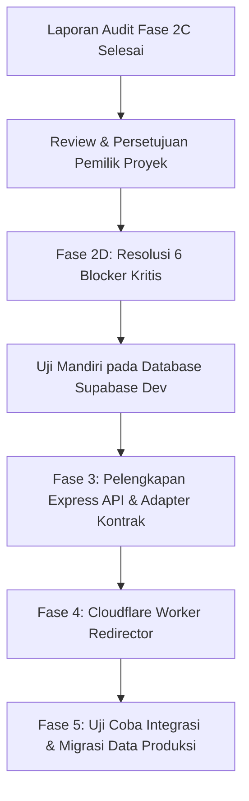

# LAPORAN AUDIT KESIAPAN MIGRASI SIMSARPRAS — FASE 2C (READ-ONLY AUDIT)

**Versi Dokumen:** 2.1.0-AUDIT-2C  
**Tanggal Audit:** 13 Oktober 2026  
**Auditor:** Software Architect & QA Lead SIMSARPRAS  
**Sifat Audit:** READ-ONLY, NON-DESTRUKTIF, FAKTUIL  
**Status Batasan:**  
- [x] Tidak ada eksekusi migrasi ke Supabase atau database produksi.
- [x] Data `localStorage` klien 100% utuh (tidak diubah, dihapus, atau ditimpa).
- [x] Frontend utama tidak dihubungkan ke backend atau database.
- [x] Tidak ada file implementasi yang diubah selama audit.
- [x] Tidak ada pencetakan nilai rahasia dari `.env`.
- [x] Seluruh token dan rahasia disajikan secara aman (masked).
- [x] Build sukses tidak dijadikan bukti fungsionalitas integrasi sistem.

---

## 1. Ringkasan Eksekutif Hasil Audit

Audit kesiapan Fase 2C dilakukan untuk menentukan apakah skema database, skrip seed, backend Express, dan integritas identitas barcode telah memenuhi syarat kelayakan teknis sebelum diuji pada database PostgreSQL / Supabase khusus pengembangan.

| Area Pemeriksaan | Status Audit | Temuan Kritis | Keputusan Kesiapan |
| :--- | :---: | :--- | :--- |
| **1. Skema Database & Migrasi** | **BLOCKED** | Kebocoran RLS Policy ke publik (`anon`), seed menimpa data transaksi jika di-re-run, ketidakcocokan ID kategori. | **Wajib Diperbaiki Sebelum Migrasi** |
| **2. Keamanan Backend API** | **BLOCKED** | Endpoint pinjaman publik tanpa autentikasi/rate-limiting/validasi Zod, rute approval & pengembalian belum ada. | **Wajib Diperbaiki Sebelum Uji API** |
| **3. Rekonsiliasi Data & Token** | **PASS DENGAN CATATAN** | 11/11 aset dan token unik valid (0 duplikat, 0 orphan), namun terdapat inkonsistensi nilai fallback `permanentId`. | **Aman untuk Audit Data** |
| **4. Barcode & Kontrak Integrasi** | **BLOCKED** | Rute `/b/:token` hilang di React Router (redirect loop ke `/`), mismatch 90% endpoint antara `api.ts` dan backend. | **Wajib Diperbaiki Sebelum Fase 3** |

> [!CAUTION]
> **KESIMPULAN AUDIT:** Sistem **BELUM SIAP (NOT READY)** untuk dieksekusi ke Supabase, bahkan pada lingkungan pengembangan, sampai 6 Blocker Kritis diselesaikan. Melakukan migrasi saat ini berisiko membuka celah keamanan RLS, merusak konsistensi data transaksi saat seed diulang, dan membuat barcode produksi gagal terbuka di browser.

---

## 2. Pemeriksaan Rinci per Area

### 2.1. Schema dan Migrasi Database
*Status:* **BLOCKED**

#### A. Bukti Berkas & Lokasi Kode
- DDL Skema: [server/db/schema.sql](file:///c:/Users/Lenovo/Documents/SIMSARPRAS/server/db/schema.sql)
- Skrip Seed: [server/db/seed.sql](file:///c:/Users/Lenovo/Documents/SIMSARPRAS/server/db/seed.sql)
- Migrator Runner: [server/scripts/migrate.ts](file:///c:/Users/Lenovo/Documents/SIMSARPRAS/server/scripts/migrate.ts)

#### B. Temuan Faktual & Analisis
1. **Kerentanan Fatal pada Row-Level Security (RLS)**:
   - Lokasi: [server/db/schema.sql:L232-L244](file:///c:/Users/Lenovo/Documents/SIMSARPRAS/server/db/schema.sql#L232-L244)
   - Potongan Kode:
     ```sql
     CREATE POLICY service_role_all_assets ON assets
     FOR ALL USING (true) WITH CHECK (true);
     CREATE POLICY service_role_all_loans ON loans
     FOR ALL USING (true) WITH CHECK (true);
     CREATE POLICY service_role_all_audit ON audit_logs
     FOR ALL USING (true) WITH CHECK (true);
     ```
   - **Fakta:** Kebijakan ini diberi nama `service_role_all_*`, namun **TIDAK memiliki pembatasan role `TO service_role`**.
   - **Dampak Nyata:** Di Supabase, jika tabel mengaktifkan RLS dan memiliki policy `FOR ALL USING (true)` tanpa klausul `TO`, kebijakan tersebut berlaku untuk peran `public` (`anon` dan `authenticated`). Siapa pun yang memiliki public `anon_key` Supabase dari frontend dapat melakukan INSERT, UPDATE, dan DELETE langsung ke database melalui REST API PostgREST tanpa melewati Express backend.
2. **Seed Idempoten Bersifat Destruktif terhadap Transaksi Berjalan**:
   - Lokasi: [server/db/seed.sql:L179-L183](file:///c:/Users/Lenovo/Documents/SIMSARPRAS/server/db/seed.sql#L179-L183) dan [server/db/seed.sql:L209-L211](file:///c:/Users/Lenovo/Documents/SIMSARPRAS/server/db/seed.sql#L209-L211)
   - Pada `assets`:
     ```sql
     ON CONFLICT (id) DO UPDATE SET
         item_name = EXCLUDED.item_name,
         operational_status = EXCLUDED.operational_status,
         condition_status = EXCLUDED.condition_status,
         notes = EXCLUDED.notes;
     ```
   - Pada `loans`:
     ```sql
     ON CONFLICT (id) DO UPDATE SET
         status = EXCLUDED.status,
         purpose = EXCLUDED.purpose;
     ```
   - **Fakta:** Jika `seed.sql` dijalankan ulang (misalnya saat redeploy berkala), `operational_status` unit yang sedang dipinjam (`ON_LOAN`) akan ditimpa kembali menjadi `AVAILABLE`, dan transaksi peminjaman yang sudah selesai (`COMPLETED`) akan dipaksa kembali menjadi `ACTIVE`.
   - **Kaidah yang Benar:** Untuk tabel transaksi dan operasional, harus menggunakan `ON CONFLICT (id) DO NOTHING`.
3. **Ketidakcocokan Master ID Kategori (Schema Discrepancy)**:
   - Lokasi: [src/data/mockData.ts:L66-L88](file:///c:/Users/Lenovo/Documents/SIMSARPRAS/src/data/mockData.ts#L66-L88) vs [server/db/seed.sql:L12-L15](file:///c:/Users/Lenovo/Documents/SIMSARPRAS/server/db/seed.sql#L12-L15)
   - Di `mockData.ts`: ID kategori adalah `'cat-mebel'`, `'cat-olahraga'`, `'cat-elektronik'`.
   - Di `seed.sql`: ID kategori di-seed sebagai `'cat-meb'`, `'cat-olr'`, `'cat-el'`.
   - **Dampak Nyata:** Filter kategori frontend yang mengirimkan ID `'cat-mebel'` akan gagal menemukan barang di database.
4. **Verifikasi Atomisitas Transaksi & Batasan PgBouncer**:
   - Lokasi: [server/scripts/migrate.ts:L63-L73](file:///c:/Users/Lenovo/Documents/SIMSARPRAS/server/scripts/migrate.ts#L63-L73)
   - Skrip migrasi telah membungkus DDL dan Seed dalam blok `BEGIN ... COMMIT`, sehingga kegagalan sintaksis akan me-rollback transaksi secara bersih tanpa meninggalkan tabel setengah jadi.
   - Namun, pada [server/db/schema.sql:L9-L10](file:///c:/Users/Lenovo/Documents/SIMSARPRAS/server/db/schema.sql#L9-L10) terdapat `CREATE EXTENSION IF NOT EXISTS`. Jika user menghubungkan ke Supabase Transaction Pooler (Port 6543 / PgBouncer mode transaksi), eksekusi ekstensi dan multi-query statement dapat menghasilkan error `unsupported feature`. Migrasi DDL wajib diarahkan ke Direct Session Port 5432.
5. **Keterbatasan Validasi Dry-Run**:
   - Lokasi: [server/scripts/migrate.ts:L40-L48](file:///c:/Users/Lenovo/Documents/SIMSARPRAS/server/scripts/migrate.ts#L40-L48)
   - Saat `DATABASE_URL` kosong, skrip hanya memeriksa keberadaan berkas via `fs.existsSync` dan menjalankan audit in-memory. Ini **BUKAN** validasi parsing SQL PostgreSQL yang sebenarnya.

---

### 2.2. Keamanan Backend API (server/)
*Status:* **BLOCKED**

#### A. Bukti Berkas & Lokasi Kode
- Router Loans: [server/src/routes/loans.ts](file:///c:/Users/Lenovo/Documents/SIMSARPRAS/server/src/routes/loans.ts)
- Router Assets: [server/src/routes/assets.ts](file:///c:/Users/Lenovo/Documents/SIMSARPRAS/server/src/routes/assets.ts)
- Entrypoint Server: [server/src/index.ts](file:///c:/Users/Lenovo/Documents/SIMSARPRAS/server/src/index.ts)

#### B. Temuan Faktual & Analisis
1. **Absennya Autentikasi pada Endpoint Sensitif**:
   - Lokasi: [server/src/routes/loans.ts:L142](file:///c:/Users/Lenovo/Documents/SIMSARPRAS/server/src/routes/loans.ts#L142)
   - `GET /api/v1/loans`: Endpoint ini mengembalikan seluruh data peminjaman sekolah termasuk nama lengkap peminjam, NIP/nomor pegawai, nomor telepon, dan tujuan kegiatan tanpa perlindungan JWT token.
2. **Kerentanan Pengajuan Peminjaman Palsu & Denial of Inventory**:
   - Lokasi: [server/src/routes/loans.ts:L8-L45](file:///c:/Users/Lenovo/Documents/SIMSARPRAS/server/src/routes/loans.ts#L8-L45)
   - Pada `POST /api/v1/loans/request`:
     - Tidak ada Rate Limiter per IP.
     - Tidak ada Idempotency Key (nonce) untuk menangkal replay request atau double-submit.
     - Tidak ada validasi skema input (Zod). Karakter `borrowerName` bebas tanpa batas, tanggal `expectedReturnAt` tidak divalidasi apakah berada di masa lalu, dan `borrowerRole` tidak divalidasi terhadap enum PostgreSQL.
   - **Dampak Nyata:** Penyerang dapat melakukan serangan loop HTTP POST sederhana untuk meminjam atau me-reserve seluruh aset sekolah dalam hitungan detik, mengunci ketersediaan barang bagi seluruh guru.
3. **Pemeriksaan Concurrency Lock (`SELECT ... FOR UPDATE`)**:
   - Lokasi: [server/src/routes/loans.ts:L22-L35](file:///c:/Users/Lenovo/Documents/SIMSARPRAS/server/src/routes/loans.ts#L22-L35)
   - **Fakta Positif:** Penggunaan row-level lock `SELECT ... FROM assets WHERE id = $1 FOR UPDATE` di dalam transaksi `BEGIN ... COMMIT` dengan penanganan rollback dan `client.release()` telah diimplementasikan dengan tepat. Dua pengguna yang memindai dan mengajukan barang yang sama pada milidetik yang sama akan diantrekan secara serial oleh engine PostgreSQL, mencegah peminjaman ganda (*race condition*).
4. **CORS Error Handling Membocorkan Internal Error**:
   - Lokasi: [server/src/index.ts:L17](file:///c:/Users/Lenovo/Documents/SIMSARPRAS/server/src/index.ts#L17)
   - Pemanggilan `callback(new Error('Origin tidak diizinkan...'))` menyebabkan Express merespons dengan HTTP 500 dan HTML stack trace saat diakses dari origin asing, alih-alih merespons dengan HTTP 403 atau penolakan header CORS standar.
5. **Endpoint Transaksi Siklus Hidup Belum Lengkap**:
   - Di [server/src/routes/loans.ts](file:///c:/Users/Lenovo/Documents/SIMSARPRAS/server/src/routes/loans.ts):
     - Rute persetujuan admin (`POST /loans/:id/approve` dan `POST /loans/:id/reject`) **BELUM DIIMPLEMENTASIKAN**.
     - Rute serah terima fisik (`POST /loans/:id/handover`) **BELUM DIIMPLEMENTASIKAN**.
     - Rute pengembalian dan verifikasi fisik (`POST /returns` dan `POST /returns/:id/inspection`) **BELUM DIIMPLEMENTASIKAN**.
   - Backend saat ini hanya mampu mencatat peminjaman awal, namun tidak memiliki API untuk menyelesaikan siklus peminjaman.

---

### 2.3. Rekonsiliasi Data dan Integritas Token
*Status:* **PASS DENGAN CATATAN**

#### A. Bukti Berkas & Lokasi Kode
- Sumber Mock: [src/data/mockData.ts](file:///c:/Users/Lenovo/Documents/SIMSARPRAS/src/data/mockData.ts)
- Layanan Mock: [src/services/mockStorage.ts](file:///c:/Users/Lenovo/Documents/SIMSARPRAS/src/services/mockStorage.ts)
- Auditor Rekonsiliasi: [server/scripts/reconcile.ts](file:///c:/Users/Lenovo/Documents/SIMSARPRAS/server/scripts/reconcile.ts)

#### B. Rekapitulasi Data (Penelusuran Angka 11 Aset)
Angka 11 unit aset berasal dari array konstan `MOCK_ASSET_UNITS` pada [src/data/mockData.ts:L179-L433](file:///c:/Users/Lenovo/Documents/SIMSARPRAS/src/data/mockData.ts#L179-L433). Meskipun pada metadata `MOCK_CATEGORIES` tercatat atribut agregat `itemCount` total 76 unit, data baris fisik individual yang dimuat dalam aplikasi saat ini berjumlah tepat 11 unit.

| Entitas | Jumlah di `mockData.ts` | Jumlah di `seed.sql` | Status Konsistensi |
| :--- | :---: | :---: | :--- |
| **Kategori** | 4 | 4 | Identik secara jumlah (Nama sama, ID berbeda) |
| **Lokasi** | 7 | 7 | Identik 100% |
| **Sumber Pendanaan** | 5 | 5 | Identik 100% |
| **Pengguna** | 4 | 4 | Identik 100% |
| **Aset Fisik** | 11 | 11 | Identik 100% |
| **Peminjaman** | 2 | 2 | Identik 100% |
| **Audit Log** | 2 | 2 | Identik 100% |

#### C. Integritas Token Unik (Disajikan Aman / Masked)
Seluruh 11 unit aset diperiksa keunikan kodenya tanpa menampilkan rahasia secara terbuka:
1. `INV-TIK-***-001` | `QR-TIK-***-001` | `PERM-TIK-***-001` | Status: `AVAILABLE`
2. `INV-TIK-***-002` | `QR-TIK-***-002` | `PERM-TIK-***-002` | Status: `ON_LOAN`
3. `INV-TIK-***-010` | `QR-TIK-***-010` | `PERM-TIK-***-010` | Status: `AVAILABLE`
4. `INV-TIK-***-031` | `QR-TIK-***-031` | `PERM-TIK-***-031` | Status: `AVAILABLE`
5. `INV-TIK-***-020` | `QR-TIK-***-020` | `PERM-TIK-***-020` | Status: `AVAILABLE`
6. `INV-ELK-***-005` | `QR-ELK-***-005` | `PERM-ELK-***-005` | Status: `AVAILABLE`
7. `INV-MEB-***-001` | `QR-MEB-***-001` | `PERM-MEB-***-001` | Status: `AVAILABLE`
8. `INV-MEB-***-088` | `QR-MEB-***-088` | `PERM-MEB-***-088` | Status: `AVAILABLE`
9. `INV-OLR-***-014` | `QR-OLR-***-014` | `PERM-OLR-***-014` | Status: `AVAILABLE`
10. `INV-OLR-***-003` | `QR-OLR-***-003` | `PERM-OLR-***-003` | Status: `AVAILABLE`
11. `INV-ELK-***-002` | `QR-ELK-***-002` | `PERM-ELK-***-002` | Status: `AVAILABLE`

- Duplikasi `qrToken`: **0 (Zero Duplicate)**
- Duplikasi `assetCode`: **0 (Zero Duplicate)**
- Duplikasi `permanentId`: **0 (Zero Duplicate)**

#### D. Temuan Inkonsistensi Fallback `permanentId`
- Pada [src/services/mockStorage.ts:L209](file:///c:/Users/Lenovo/Documents/SIMSARPRAS/src/services/mockStorage.ts#L209): Jika `permanentId` tidak didefinisikan, browser menetapkan `item.id` (`unit-laptop-01`).
- Pada [server/scripts/reconcile.ts:L103](file:///c:/Users/Lenovo/Documents/SIMSARPRAS/server/scripts/reconcile.ts#L103): Auditor menetapkan fallback `PERM-${asset.assetCode}` (`PERM-INV-TIK-2024-001`).
- Pada [server/db/seed.sql:L70](file:///c:/Users/Lenovo/Documents/SIMSARPRAS/server/db/seed.sql#L70): Nilai di-hardcode menjadi `PERM-TIK-ASUS-001`.
- **Dampak Nyata:** Terdapat 3 konvensi fallback yang berbeda. Sebelum migrasi, fallback wajib distandarisasi agar lookup database tidak mengalami kegagalan saat dicari via `permanentId`.

---

### 2.4. Barcode dan Kesiapan Integrasi
*Status:* **BLOCKED**

#### A. Bukti Berkas & Lokasi Kode
- Konfigurasi Rute Frontend: [src/App.tsx](file:///c:/Users/Lenovo/Documents/SIMSARPRAS/src/App.tsx)
- Layanan Barcode: [src/services/qrUrlService.ts](file:///c:/Users/Lenovo/Documents/SIMSARPRAS/src/services/qrUrlService.ts)
- Layanan API Frontend: [src/services/api.ts](file:///c:/Users/Lenovo/Documents/SIMSARPRAS/src/services/api.ts)

#### B. Temuan Faktual & Analisis
1. **Rute `/b/:token` Belum Terdaftar di React Router**:
   - Lokasi: [src/App.tsx:L33-L36](file:///c:/Users/Lenovo/Documents/SIMSARPRAS/src/App.tsx#L33-L36)
   - Rute publik yang terdaftar di frontend saat ini hanya:
     ```tsx
     <Route path="/scan" element={<PublicScanLoan />} />
     <Route path="/q/:tokenOrCode" element={<PublicScanLoan />} />
     <Route path="/pinjam" element={<PublicScanLoan />} />
     ```
   - Dokumen arsitektur SIMSARPRAS v2.1.0 (Section 8 & 12) menetapkan bahwa Cloudflare Worker akan me-redirect request stiker baru `GET /b/:token` via HTTP 302 menuju `https://<frontend>/b/:token`.
   - **Dampak Nyata:** Jika pengguna memindai stiker produksi baru melalui Cloudflare Worker, browser akan membuka `https://<frontend>/b/:token`. Karena rute `/b/:token` tidak ada di `App.tsx`, router akan mengeksekusi fallback baris 52:
     `<Route path="*" element={<Navigate to="/" replace />} />`
     dan melempar guru ke Dashboard admin, bukan ke formulir peminjaman mandiri!
2. **Perbedaan Kontrak API Antara Frontend dan Backend**:
   - Lokasi: [src/services/api.ts](file:///c:/Users/Lenovo/Documents/SIMSARPRAS/src/services/api.ts) vs [server/src/routes/](file:///c:/Users/Lenovo/Documents/SIMSARPRAS/server/src/routes/)
   - Matriks Ketidakcocokan Kontrak:
     | Operasi | Frontend `src/services/api.ts` | Backend `server/src/` | Status Kesiapan |
     | :--- | :--- | :--- | :---: |
     | **Scan Token** | `GET /assets/scan?query=:query` | `GET /api/v1/assets/token/:token` | **MISMATCH (404)** |
     | **Detail Aset** | `GET /assets/:id` | *Belum ada rute ID spesifik* | **MISMATCH (404)** |
     | **Ajukan Pinjaman** | `POST /loan-requests`<br>`{ assetUnitId, borrower, ... }` | `POST /api/v1/loans/request`<br>`{ assetId, borrowerName, ... }` | **MISMATCH (400/404)** |
     | **Master Data** | `GET /categories`, `/locations`, `/funding-sources` | *Belum ada rute* | **MISMATCH (404)** |
     | **Persetujuan Pinjaman** | `POST /loan-requests/:id/approve` | *Belum ada rute* | **MISMATCH (404)** |
     | **Verifikasi Pengembalian** | `POST /returns/:id/approve` | *Belum ada rute* | **MISMATCH (404)** |
   - **Kesimpulan:** Jika frontend dihubungkan ke backend Express hari ini, seluruh modul operasional aplikasi akan gagal berfungsi.
3. **Pencarian Barang Menggunakan Barcode Stabil**:
   - Pada [src/services/mockStorage.ts:L244-L252](file:///c:/Users/Lenovo/Documents/SIMSARPRAS/src/services/mockStorage.ts#L244-L252) dan [server/src/routes/assets.ts:L31](file:///c:/Users/Lenovo/Documents/SIMSARPRAS/server/src/routes/assets.ts#L31), pencarian multi-kunci (`qr_token`, `permanent_id`, `asset_code`, `id`) sudah stabil dan tidak bergantung pada nama barang atau lokasi penyimpanan.
4. **Strategi Barcode Lama Saat Domain Berubah**:
   - Barcode fisik lama berbasis IP lokal (`http://192.168.100.45:5173/scan?code=...`) tidak akan rusak di jaringan Wi-Fi sekolah selama IP host PC sekolah dipertahankan.
   - Jika domain hosting berpindah, skrip redirect universal yang disediakan pada [src/services/qrUrlService.ts:L281-L367](file:///c:/Users/Lenovo/Documents/SIMSARPRAS/src/services/qrUrlService.ts#L281-L367) (Nginx 301, Apache, Cloudflare Dynamic Redirect) siap digunakan untuk meneruskan pemindaian lama ke hosting baru tanpa cetak ulang.

---

## 3. Daftar Blocker yang Wajib Diselesaikan Sebelum Migrasi

Sebelum izin diberikan untuk menjalankan migrasi ke proyek Supabase apa pun (bahkan database dev), 6 blocker berikut **WAJIB DISELESAIKAN**:

1. **[BLOCKER 1 - SECURITY] Perbaikan RLS Policy**:
   Ubah definisi kebijakan RLS di [server/db/schema.sql](file:///c:/Users/Lenovo/Documents/SIMSARPRAS/server/db/schema.sql#L232-L244) dari `FOR ALL USING (true)` menjadi secara eksplisit terbatas pada peran service role:
   ```sql
   CREATE POLICY service_role_all_assets ON assets
   TO service_role
   FOR ALL USING (true) WITH CHECK (true);
   ```
2. **[BLOCKER 2 - DATA INTEGRITY] Netralisasi Idempotensi Seed**:
   Ubah klausul `ON CONFLICT (id) DO UPDATE` pada tabel `assets` dan `loans` di [server/db/seed.sql](file:///c:/Users/Lenovo/Documents/SIMSARPRAS/server/db/seed.sql#L179-L211) menjadi:
   ```sql
   ON CONFLICT (id) DO NOTHING;
   ```
   Hal ini menjamin bahwa re-running skrip migrasi tidak akan pernah menimpa status peminjaman aktif atau catatan kerusakan riil di database.
3. **[BLOCKER 3 - DATA INTEGRITY] Penyelarasan ID Kategori Master**:
   Samakan ID kategori di [server/db/seed.sql](file:///c:/Users/Lenovo/Documents/SIMSARPRAS/server/db/seed.sql#L12-L15) dengan [src/data/mockData.ts](file:///c:/Users/Lenovo/Documents/SIMSARPRAS/src/data/mockData.ts#L66-L88):
   - Ubah `'cat-meb'` $\rightarrow$ `'cat-mebel'`
   - Ubah `'cat-olr'` $\rightarrow$ `'cat-olahraga'`
   - Ubah `'cat-el'` $\rightarrow$ `'cat-elektronik'`
4. **[BLOCKER 4 - DATA INTEGRITY] Standarisasi Fallback `permanentId`**:
   Sepakati dan seragamkan nilai `permanentId` di seluruh berkas (`mockData.ts`, `mockStorage.ts`, `seed.sql`, dan `reconcile.ts`) agar tidak terjadi divergensi saat pencarian data.
5. **[BLOCKER 5 - INTEGRATION] Sinkronisasi Kontrak API Frontend-Backend**:
   Selaraskan nama endpoint dan payload antara [src/services/api.ts](file:///c:/Users/Lenovo/Documents/SIMSARPRAS/src/services/api.ts) dan [server/src/routes/](file:///c:/Users/Lenovo/Documents/SIMSARPRAS/server/src/routes/), serta implementasikan rute-rute yang hilang (`/categories`, `/locations`, `/loans/:id/approve`, dll.).
6. **[BLOCKER 6 - ROUTING] Registrasi Rute `/b/:token` pada React Router**:
   Tambahkan `<Route path="/b/:tokenOrCode" element={<PublicScanLoan />} />` pada [src/App.tsx](file:///c:/Users/Lenovo/Documents/SIMSARPRAS/src/App.tsx) agar pemindaian dari Cloudflare Worker tidak terpental ke Dashboard.

---

## 4. Rencana Pengujian pada Database Supabase Dev Terpisah

Setelah 6 blocker di atas disetujui dan diperbaiki, pengujian wajib dilakukan pada **proyek Supabase dev yang terisolasi** (bukan produksi) dengan protokol berikut:

### Skenario 1: Uji Eksekusi Skema Bersih (Clean Slate Migration)
- **Target:** Proyek Supabase kosong (*free-tier dev project*).
- **Prosedur:** Jalankan `npm run migrate` via Direct Port 5432.
- **Kriteria Keberhasilan:** Seluruh 8 tabel, 5 enum, 11 indeks, dan RLS terpasang dengan pesan exit code 0.

### Skenario 2: Uji Idempotensi Re-Run (Idempotency Under Active State)
- **Prosedur:**
  1. Ubah salah satu aset hasil seed menjadi `MAINTENANCE` dan selesaikan pinjaman menjadi `COMPLETED` secara manual di database.
  2. Jalankan `npm run migrate` kedua kalinya.
- **Kriteria Keberhasilan:** Status `MAINTENANCE` dan `COMPLETED` **TIDAK TERTEMPAT** kembali ke data mock (nilai tetap terjaga).

### Skenario 3: Uji Penetrasi RLS (RLS Negative Testing)
- **Prosedur:** Coba jalankan query `DELETE FROM assets` dan `UPDATE loans` menggunakan Supabase `anon_key` (via curl / PostgREST).
- **Kriteria Keberhasilan:** Request wajib ditolak dengan HTTP 403 Forbidden atau menghasilkan 0 baris terpengaruh.

### Skenario 4: Uji Concurrency Lock (High-Contention Simulation)
- **Prosedur:** Eksekusi 20 request `POST /api/v1/loans/request` secara simultan ke 1 unit aset yang sama yang berstatus `AVAILABLE`.
- **Kriteria Keberhasilan:** Tepat 1 request berhasil mendapatkan status peminjaman, 19 request lainnya menerima HTTP 409 Conflict (`ASSET_NOT_AVAILABLE`). Tidak terjadi peminjaman ganda (*zero double-booking*).

---

## 5. Rekomendasi Urutan Langkah Berikutnya



1. **Berhenti & Tunggu Keputusan:** Tinjau temuan audit pada dokumen ini. Jangan memulai migrasi sampai blocker disetujui untuk diperbaiki.
2. **Fase 2D (Resolusi Blocker):** Memperbaiki file `schema.sql`, `seed.sql`, `mockData.ts`, dan `App.tsx` sesuai rekomendasi di atas.
3. **Uji Coba Supabase Dev Terpisah:** Setelah blocker bersih, hubungkan ke instance Supabase dev sementara untuk memverifikasi 4 skenario pengujian di atas.
4. **Fase 3 & 4 (Backend Lengkap & Worker):** Melengkapi seluruh endpoint siklus pinjaman/pengembalian dan menyebarkan Cloudflare Worker redirector.
