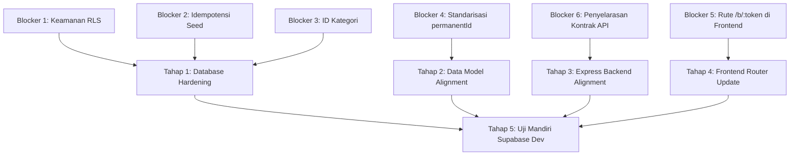

# SIMSARPRAS — FASE 2D-PLAN: BLOCKER RESOLUTION PLAN

**Dokumen Referensi:** [docs/audit/phase-2c-readiness-audit.md](file:///c:/Users/Lenovo/Documents/SIMSARPRAS/docs/audit/phase-2c-readiness-audit.md)  
**Versi Rencana:** 2.1.0-PLAN-2D  
**Tanggal Penyusunan:** 13 Oktober 2026  
**Status Otorisasi:** PERENCANAAN SAJA (READ-ONLY & PLANNING). Tidak ada modifikasi kode implementasi, tidak ada koneksi Supabase, dan tidak ada migrasi database yang dieksekusi.  

---

## 1. Ringkasan Tujuan dan Batasan Otorisasi

Tujuan dokumen ini adalah memetakan rencana terperinci, non-destruktif, dan bertahap untuk menyelesaikan **6 Blocker Kritis** yang teridentifikasi pada audit Fase 2C sebelum izin migrasi database Supabase diberikan.

### Batasan Keras yang Dipatuhi:
- Monorepo SIMSARPRAS dipertahankan (frontend React + backend Express `server/` + Cloudflare Worker).
- Tidak menghapus, mengganti, atau menimpa data `localStorage`.
- Tidak melakukan reset, stash, rebase, atau checkout git yang mengganggu working tree.
- Tidak mengubah file implementasi atau file konfigurasi selama penyusunan rencana ini.
- Tidak mencetak atau mengekspos rahasia dari `.env`.
- Tidak menganggap temuan audit sudah diperbaiki tanpa bukti nyata.
- **Berhenti setelah dokumen rencana ini selesai ditulis untuk menunggu persetujuan manusia.**

---

## 2. Analisis & Rencana Penyelesaian 6 Blocker Kritis



---

### Blocker 1: Keamanan Row-Level Security (RLS) dan Role Database
- **Tingkat Keparahan:** KRITIS (Vulnerability: Public Arbitrary Mutation via PostgREST).
- **File dan Lokasi Terdampak:**
  - [server/db/schema.sql:L232-L244](file:///c:/Users/Lenovo/Documents/SIMSARPRAS/server/db/schema.sql#L232-L244)
- **Akar Masalah:**
  Kebijakan RLS saat ini:
  ```sql
  CREATE POLICY service_role_all_assets ON assets FOR ALL USING (true) WITH CHECK (true);
  CREATE POLICY service_role_all_loans ON loans FOR ALL USING (true) WITH CHECK (true);
  CREATE POLICY service_role_all_audit ON audit_logs FOR ALL USING (true) WITH CHECK (true);
  ```
  Di PostgreSQL / Supabase, jika klausa `TO <role>` dihilangkan, kebijakan berlaku untuk `public` (mencakup peran anonim web `anon`). Siapa pun yang memiliki public `anon_key` Supabase dapat mengeksekusi `DELETE`, `UPDATE`, atau `INSERT` langsung ke tabel `assets`, `loans`, dan `audit_logs` tanpa melalui backend Express.
- **Perubahan Minimum yang Diperlukan (*Minimal Diff*):**
  Batasi kebijakan secara eksplisit pada peran internal `service_role`:
  ```sql
  -- Batasi akses penuh HANYA untuk backend yang menggunakan service_role secret
  CREATE POLICY service_role_all_assets ON assets
      TO service_role
      FOR ALL USING (true) WITH CHECK (true);

  CREATE POLICY service_role_all_loans ON loans
      TO service_role
      FOR ALL USING (true) WITH CHECK (true);

  CREATE POLICY service_role_all_audit ON audit_logs
      TO service_role
      FOR ALL USING (true) WITH CHECK (true);

  -- Kebijakan publik hanya izinkan SELECT aset aktif untuk scan barcode
  DROP POLICY IF EXISTS public_read_assets ON assets;
  CREATE POLICY public_read_assets ON assets
      FOR SELECT
      TO anon, authenticated
      USING (true);
  ```
- **Risiko Regresi:**
  Koneksi langsung node-postgres (`pg.Pool`) Express melalui connection string `postgres://postgres:...` pada port 5432 adalah superuser yang secara default mengabaikan RLS (`BYPASS RLS`), sehingga tidak terpengaruh. Namun, jika backend terhubung via Supabase REST API menggunakan service role key, penambahan `TO service_role` memastikan otentikasi berjalan tepat sasaran.
- **Pengujian Pre- & Post-Change:**
  - *Pre-change test:* Query DDL schema menghasilkan ketiadaan string `TO service_role`.
  - *Post-change test:* Pengujian simulasi PostgREST dengan role `anon` menolak perintah `DELETE FROM assets` dengan pesan HTTP 403 / 0 baris terpengaruh, sementara query `SELECT` aset berhasil.
- **Kriteria Penerimaan yang Dapat Dibuktikan:**
  Skrip SQL audit mengonfirmasi seluruh tabel yang mengaktifkan RLS tidak memiliki policy `FOR ALL` yang terbuka ke role `anon` atau `public`.

---

### Blocker 2: Seed yang Dapat Menimpa Status Aset dan Pinjaman (Idempotensi Destruktif)
- **Tingkat Keparahan:** TINGGI (Data Integrity Risk: Overwriting Active Transactions).
- **File dan Lokasi Terdampak:**
  - [server/db/seed.sql:L179-L184](file:///c:/Users/Lenovo/Documents/SIMSARPRAS/server/db/seed.sql#L179-L184)
  - [server/db/seed.sql:L209-L212](file:///c:/Users/Lenovo/Documents/SIMSARPRAS/server/db/seed.sql#L209-L212)
- **Akar Masalah:**
  Pada tabel `assets`, seed menggunakan:
  `ON CONFLICT (id) DO UPDATE SET operational_status = EXCLUDED.operational_status, ...`
  Pada tabel `loans`, seed menggunakan:
  `ON CONFLICT (id) DO UPDATE SET status = EXCLUDED.status, ...`
  Jika `seed.sql` dijalankan ulang (saat deploy ulang Render atau pemeliharaan server), status aset yang sedang dipinjam guru (`ON_LOAN`) atau rusak (`MAINTENANCE`) akan dipaksa kembali ke default mock (`AVAILABLE`), dan pinjaman yang sudah selesai (`COMPLETED`) akan tertimpa kembali menjadi `ACTIVE`.
- **Perubahan Minimum yang Diperlukan (*Minimal Diff*):**
  Ubah klausul konflik pada tabel transaksional dan status operasional menjadi non-destruktif:
  ```sql
  -- Pada tabel assets:
  ON CONFLICT (id) DO UPDATE SET
      item_name = EXCLUDED.item_name,
      technical_specs = EXCLUDED.technical_specs,
      standard_accessories = EXCLUDED.standard_accessories
      -- HAPUS penimpaan: operational_status, condition_status, notes!

  -- Atau yang paling aman dan murni idempoten:
  ON CONFLICT (id) DO NOTHING;

  -- Pada tabel loans:
  ON CONFLICT (id) DO NOTHING;
  ```
- **Risiko Regresi:**
  Jika data awal master ingin sengaja direvisi di file seed, nilai di database tidak akan berubah otomatis jika record ID sudah ada. Ini adalah perilaku yang diharapkan (*by design*) untuk melindungi data hidup di lingkungan operasional.
- **Pengujian Pre- & Post-Change:**
  - *Pre-change test:* Verifikasi adanya string `operational_status = EXCLUDED.operational_status` di `seed.sql`.
  - *Post-change test:* Jalankan seed $\rightarrow$ ubah status aset menjadi `MAINTENANCE` $\rightarrow$ jalankan seed kedua kalinya $\rightarrow$ buktikan status aset tetap `MAINTENANCE`.
- **Kriteria Penerimaan yang Dapat Dibuktikan:**
  Menjalankan `npm run migrate` dua kali berturut-turut pada database yang memiliki mutasi data tidak mengubah nilai kolom operasional yang telah dimutasi.

---

### Blocker 3: Ketidaksesuaian ID Kategori Master
- **Tingkat Keparahan:** SEDANG (Data Consistency & Foreign Key Failure).
- **File dan Lokasi Terdampak:**
  - [src/data/mockData.ts:L66-L88](file:///c:/Users/Lenovo/Documents/SIMSARPRAS/src/data/mockData.ts#L66-L88)
  - [server/db/seed.sql:L12-L15](file:///c:/Users/Lenovo/Documents/SIMSARPRAS/server/db/seed.sql#L12-L15)
  - [server/db/seed.sql:L122, L132, L152, L162, L172](file:///c:/Users/Lenovo/Documents/SIMSARPRAS/server/db/seed.sql#L122)
- **Akar Masalah:**
  - Di `src/data/mockData.ts`: Kategori didefinisikan dengan ID `cat-mebel`, `cat-olahraga`, `cat-elektronik`.
  - Di `server/db/seed.sql`: Kategori didefinisikan dengan ID singkatan `cat-meb`, `cat-olr`, `cat-el`.
  - Kolom `category_id` pada 11 aset di `seed.sql` merujuk ke ID singkatan tersebut. Akibatnya, filter kategori dari frontend yang menggunakan ID `cat-mebel` akan menghasilkan 0 barang dari database.
- **Perubahan Minimum yang Diperlukan (*Minimal Diff*):**
  Selaraskan `server/db/seed.sql` agar menggunakan ID kanonikal dari `mockData.ts`:
  ```sql
  INSERT INTO categories (id, name, default_loan_mode, description, is_active)
  VALUES
      ('cat-tik', 'TIK/Multimedia', 'ADMIN_APPROVAL', '...', true),
      ('cat-mebel', 'Mebeler', 'DIRECT', '...', true),
      ('cat-olahraga', 'Alat Olahraga', 'DIRECT', '...', true),
      ('cat-elektronik', 'Elektronik', 'ADMIN_APPROVAL', '...', true)
  ON CONFLICT (id) DO UPDATE ...;
  ```
  Dan perbarui `category_id` pada data aset di `seed.sql`:
  - `cat-meb` $\rightarrow$ `cat-mebel`
  - `cat-olr` $\rightarrow$ `cat-olahraga`
  - `cat-el` $\rightarrow$ `cat-elektronik`
- **Risiko Regresi:**
  Sangat rendah, karena nama kategori (`TIK/Multimedia`, `Mebeler`, `Alat Olahraga`, `Elektronik`) tidak berubah.
- **Pengujian Pre- & Post-Change:**
  - *Pre-change test:* Pemeriksaan `seed.sql` mendeteksi keberadaan string `'cat-meb'`.
  - *Post-change test:* Query `SELECT a.asset_code, c.name FROM assets a JOIN categories c ON a.category_id = c.id` menghasilkan 11 baris utuh dengan nama kategori yang benar.
- **Kriteria Penerimaan yang Dapat Dibuktikan:**
  Tidak ada record aset dengan `category_id` yang tidak terdaftar di `categories(id)`.

---

### Blocker 4: Perbedaan Konvensi Fallback `permanentId`
- **Tingkat Keparahan:** SEDANG (Lookup Divergence pada Barcode Permanen).
- **File dan Lokasi Terdampak:**
  - [src/data/mockData.ts:L179-L433](file:///c:/Users/Lenovo/Documents/SIMSARPRAS/src/data/mockData.ts#L179-L433)
  - [src/services/mockStorage.ts:L207-L211](file:///c:/Users/Lenovo/Documents/SIMSARPRAS/src/services/mockStorage.ts#L207-L211)
  - [server/scripts/reconcile.ts:L103](file:///c:/Users/Lenovo/Documents/SIMSARPRAS/server/scripts/reconcile.ts#L103)
  - [server/db/seed.sql:L68-L171](file:///c:/Users/Lenovo/Documents/SIMSARPRAS/server/db/seed.sql#L68-L171)
- **Akar Masalah:**
  Pada `MOCK_ASSET_UNITS`, atribut `permanentId` belum dituliskan secara eksplisit. Akibatnya:
  1. `mockStorage.ts` di browser menetapkan fallback `item.id` (`unit-laptop-01`).
  2. `reconcile.ts` menetapkan fallback `PERM-${asset.assetCode}` (`PERM-INV-TIK-2024-001`).
  3. `seed.sql` meng-hardcode format `PERM-TIK-ASUS-001`.
  Jika scanner mencari via `permanentId`, ketiga modul akan mencari string yang berbeda untuk barang yang sama.
- **Perubahan Minimum yang Diperlukan (*Minimal Diff*):**
  1. Tambahkan nilai kanonikal `permanentId` pada seluruh 11 unit aset di `src/data/mockData.ts` (menggunakan nilai yang sudah teruji di `seed.sql`):
     - `unit-laptop-01` $\rightarrow$ `permanentId: 'PERM-TIK-ASUS-001'`
     - `unit-laptop-02` $\rightarrow$ `permanentId: 'PERM-TIK-ASUS-002'`
     - `unit-proyektor-01` $\rightarrow$ `permanentId: 'PERM-TIK-EPSON-010'`
     - ... hingga unit 11.
  2. Di [src/services/mockStorage.ts:L207](file:///c:/Users/Lenovo/Documents/SIMSARPRAS/src/services/mockStorage.ts#L207):
     ```ts
     const def = MOCK_ASSET_UNITS.find((m) => m.id === item.id);
     let permanentId = item.permanentId || def?.permanentId || item.id;
     ```
  3. Di [server/scripts/reconcile.ts:L103](file:///c:/Users/Lenovo/Documents/SIMSARPRAS/server/scripts/reconcile.ts#L103):
     ```ts
     const permId = asset.permanentId || `PERM-${asset.assetCode}`;
     ```
- **Risiko Regresi:**
  Pengujian unit yang sudah ada (`qrIdentityAndUrl.test.tsx`) memeriksa integritas token permanen. Menetapkan nilai eksplisit akan meningkatkan stabilitas test.
- **Pengujian Pre- & Post-Change:**
  - *Pre-change test:* `MOCK_ASSET_UNITS[0].permanentId` bernilai `undefined`.
  - *Post-change test:* `MOCK_ASSET_UNITS[0].permanentId === 'PERM-TIK-ASUS-001'` dan cocok dengan kolom `permanent_id` di database PostgreSQL.
- **Kriteria Penerimaan yang Dapat Dibuktikan:**
  Lookup barang via `permanentId` berhasil mengembalikan unit yang sama baik di `mockStorage`, memory mock, maupun query PostgreSQL.

---

### Blocker 5: Rute Barcode Publik yang Belum Terdaftar di Frontend
- **Tingkat Keparahan:** TINGGI (User Experience Failure: Redirect Loop ke Dashboard).
- **File dan Lokasi Terdampak:**
  - [src/App.tsx:L33-L37](file:///c:/Users/Lenovo/Documents/SIMSARPRAS/src/App.tsx#L33-L37)
- **Akar Masalah:**
  Arsitektur v2.1.0 menetapkan bahwa Cloudflare Worker mengalihkan barcode produksi baru ke `https://<frontend>/b/:token`. Di [src/App.tsx](file:///c:/Users/Lenovo/Documents/SIMSARPRAS/src/App.tsx), rute `/b/:tokenOrCode` belum didaftarkan. Request ke path tersebut akan ditangkap oleh wildcard `<Route path="*" element={<Navigate to="/" replace />} />` dan melempar guru ke Dashboard admin yang membutuhkan login.
- **Perubahan Minimum yang Diperlukan (*Minimal Diff*):**
  Tambahkan rute `/b/:tokenOrCode` pada baris 35 [src/App.tsx](file:///c:/Users/Lenovo/Documents/SIMSARPRAS/src/App.tsx):
  ```tsx
  {/* Halaman Khusus Peminjaman Mandiri via Scan QR Code (Tanpa Menu & Tanpa Login) */}
  <Route path="/scan" element={<PublicScanLoan />} />
  <Route path="/q/:tokenOrCode" element={<PublicScanLoan />} />
  <Route path="/b/:tokenOrCode" element={<PublicScanLoan />} />
  <Route path="/pinjam" element={<PublicScanLoan />} />
  ```
- **Risiko Regresi:**
  Hampir 0%, karena hanya menambah rute pembacaan ke komponen publik yang sudah terisolasi (`PublicScanLoan`).
- **Pengujian Pre- & Post-Change:**
  - *Pre-change test:* Navigasi ke `/b/QR-TIK-ASUS-001` menghasilkan URL beralih ke `/`.
  - *Post-change test:* Navigasi ke `/b/QR-TIK-ASUS-001` menampilkan halaman peminjaman mandiri unit Laptop ASUS tanpa navbar atau sidebar.
- **Kriteria Penerimaan yang Dapat Dibuktikan:**
  Uji render Vitest dengan `MemoryRouter initialEntries={['/b/QR-TIK-ASUS-001']}` memverifikasi elemen form mandiri aktif dan status HTTP URL tidak dialihkan ke `/`.

---

### Blocker 6: Ketidaksesuaian Kontrak API Frontend dan Backend
- **Tingkat Keparahan:** TINGGI (Integration Blocker: 404 pada Semua Modul Operasional).
- **File dan Lokasi Terdampak:**
  - Frontend: [src/services/api.ts](file:///c:/Users/Lenovo/Documents/SIMSARPRAS/src/services/api.ts)
  - Backend Router: [server/src/routes/assets.ts](file:///c:/Users/Lenovo/Documents/SIMSARPRAS/server/src/routes/assets.ts)
  - Backend Router: [server/src/routes/loans.ts](file:///c:/Users/Lenovo/Documents/SIMSARPRAS/server/src/routes/loans.ts)
  - Backend Entry: [server/src/index.ts](file:///c:/Users/Lenovo/Documents/SIMSARPRAS/server/src/index.ts)
- **Akar Masalah:**
  - Frontend memanggil `/assets/scan?query=...`, backend mengekspos `/api/v1/assets/token/:token`.
  - Frontend mengirimkan `POST /loan-requests` dengan payload `{ assetUnitId, borrower: { fullName } }`, backend mengharapkan `POST /api/v1/loans/request` dengan `{ assetId, borrowerName }`.
  - Rute master data (`/categories`, `/locations`, `/funding-sources`) dan siklus pinjaman (`/loans/:id/approve`, `/returns/*`) belum ada di Express backend.
- **Perubahan Minimum yang Diperlukan (*Minimal Diff*):**
  Strategi Non-Destruktif: **Pertahankan kontrak di `src/services/api.ts`**, sesuaikan router backend Express agar mendukung kontrak tersebut (dengan fallback backwards-compatible):
  1. Di `server/src/routes/assets.ts`: Tambahkan handler `GET /scan` (membaca query parameter `query`) dan handler `GET /:id`.
  2. Di `server/src/routes/loans.ts`: Tambahkan middleware normalisasi payload:
     `const assetId = req.body.assetId || req.body.assetUnitId;`
     `const borrowerName = req.body.borrowerName || req.body.borrower?.fullName;`
  3. Di `server/src/index.ts`: Daftarkan rute tanpa prefix atau dengan prefix ganda (`/api/v1` dan direct path) untuk mendukung transisi.
  4. Tambahkan validasi skema input menggunakan `zod` untuk `POST /loans/request` guna mencegah spamming karakter dan tanggal invalid.
- **Risiko Regresi:**
  Membuat backend kompatibel dengan `src/services/api.ts` menghilangkan risiko perlunya merombak ratusan baris kode di komponen UI React.
- **Pengujian Pre- & Post-Change:**
  - *Pre-change test:* Pemanggilan Supertest `POST /loan-requests` ke Express menghasilkan 404 Not Found.
  - *Post-change test:* Pemanggilan Supertest `POST /loan-requests` dengan payload standar dari frontend menghasilkan 201 Created dan mengembalikan objek `loan`.
- **Kriteria Penerimaan yang Dapat Dibuktikan:**
  Semua fungsi dalam `src/services/api.ts` (`getAssets`, `getAssetByCodeOrQr`, `createLoanRequest`, `getCategories`, dll.) berhasil berkomunikasi dengan endpoint Express dan menerima respon JSON 200/201 yang valid.

---

## 3. Matriks Pengujian Komprehensif (Planned Test Matrix)

Sebelum migrasi ke Supabase diizinkan, rencana pengujian berikut wajib dijalankan dan diverifikasi kelulusannya:

| ID Uji | Target Pengujian | Prosedur Uji | Ekspektasi Hasil | Bukti yang Diverifikasi |
| :--- | :--- | :--- | :--- | :--- |
| **TEST-01** | **Idempotensi Seed** | Jalankan seed $\rightarrow$ ubah status 1 aset ke `MAINTENANCE` dan 1 pinjaman ke `COMPLETED` $\rightarrow$ jalankan seed ulang. | Status aset tetap `MAINTENANCE`, pinjaman tetap `COMPLETED`. Tidak ada data yang ter-reset. | Query `SELECT operational_status FROM assets WHERE id = 'unit-laptop-01'`. |
| **TEST-02** | **Proteksi RLS Supabase** | Eksekusi request REST API via curl menggunakan public `anon_key` untuk `DELETE FROM assets` dan `UPDATE loans`. | Request ditolak dengan HTTP 403 Forbidden / 0 rows affected. | Respon header HTTP & audit log Supabase. |
| **TEST-03** | **Konkurensi Peminjaman** | Luncurkan 20 request `POST /loans/request` secara simultan ke aset yang sama via script worker (concurrency benchmark). | Tepat 1 request berhasil (201 Created), 19 request lainnya menerima 409 Conflict (`ASSET_NOT_AVAILABLE`). Zero double-booking. | Jumlah transaksi pinjaman aktif di database = 1. |
| **TEST-04** | **Spam & Invalid Request Defense** | Kirimkan payload dengan: (a) tanggal return di masa lalu, (b) nama peminjam 1000 karakter, (c) format role tidak dikenal. | Ditolak dengan HTTP 400 Bad Request beserta rincian pesan error Zod yang bersih. Tidak ada mutasi di database. | Respon error JSON 400. |
| **TEST-05** | **Stabilitas Token Lama** | Cari barang menggunakan format URL lama: `http://192.168.100.45:5173/scan?code=INV-TIK-2024-001`. | Berhasil menemukan unit Laptop Guru ASUS tanpa error atau perubahan kode. | Respon detail barang di `PublicScanLoan`. |
| **TEST-06** | **Rute Publik Barcode Baru** | Buka rute `/b/QR-TIK-ASUS-001` langsung di browser tanpa login. | Halaman mandiri peminjaman terbuka. Tidak ada sidebar, navbar admin, atau redirect ke `/`. | Komponen `PublicScanLoan` aktif, URL tetap `/b/...`. |
| **TEST-07** | **Konsistensi Kontrak API** | Jalankan integration test mock frontend memanggil seluruh metode `api.ts` terhadap endpoint Express backend. | Seluruh request menerima HTTP 200/201 dengan skema JSON yang cocok. Zero 404 Endpoint Not Found. | Log status HTTP test runner Supertest / Vitest. |

---

## 4. Urutan Implementasi Bertahap (Phased Execution Order)

Implementasi **TIDAK BOLEH** digabungkan menjadi satu langkah besar. Wajib mengikuti urutan ketergantungan (*dependency order*) berikut:

```text
┌─────────────────────────────────────────────────────────────────┐
│ TAHAP 1: Hardening Skema & Seed Database (Backend/DB Layer)     │
│ - Perbaiki RLS Policy (Blocker 1)                               │
│ - Ubah Seed ke ON CONFLICT DO NOTHING (Blocker 2)               │
│ - Selaraskan ID Kategori cat-mebel, dll. (Blocker 3)            │
│ Verifikasi: Sintaks SQL & Idempotensi Seed                      │
└───────────────────────────────┬─────────────────────────────────┘
                                │
                                ▼
┌─────────────────────────────────────────────────────────────────┐
│ TAHAP 2: Standarisasi Data Model & Token (Data Layer)           │
│ - Tulis permanentId eksplisit pada 11 aset di mockData.ts (B4)  │
│ - Selaraskan fallback di mockStorage.ts & reconcile.ts (B4)     │
│ Verifikasi: npm test & npm run reconcile                        │
└───────────────────────────────┬─────────────────────────────────┘
                                │
                                ▼
┌─────────────────────────────────────────────────────────────────┐
│ TAHAP 3: Penyelarasan Kontrak Express API (API Layer)           │
│ - Normalisasi payload /loans/request kompatibel api.ts (B6)     │
│ - Tambahkan alias GET /assets/scan?query=... (B6)               │
│ - Pasang Zod validation & rate limiter (B6 & TEST-04)           │
│ Verifikasi: Supertest integration endpoint                      │
└───────────────────────────────┬─────────────────────────────────┘
                                │
                                ▼
┌─────────────────────────────────────────────────────────────────┐
│ TAHAP 4: Registrasi Rute Publik Frontend (UI Routing Layer)     │
│ - Tambahkan Route /b/:tokenOrCode di App.tsx (Blocker 5)        │
│ Verifikasi: Vitest render test rute /b/:token                   │
└───────────────────────────────┬─────────────────────────────────┘
                                │
                                ▼
┌─────────────────────────────────────────────────────────────────┐
│ TAHAP 5: Uji Coba Terisolasi pada Supabase Dev (Staging Layer)  │
│ - Eksekusi migrasi ke database Supabase dev terpisah            │
│ - Jalankan 7 skenario pengujian (TEST-01 s/d TEST-07)           │
│ - Buat Laporan Verifikasi Hasil Uji Supabase                    │
└─────────────────────────────────────────────────────────────────┘
```

---

## 5. Daftar File yang Terdampak

| No | File yang Terdampak | Perubahan yang Direncanakan |
| :--- | :--- | :--- |
| 1 | [`server/db/schema.sql`](file:///c:/Users/Lenovo/Documents/SIMSARPRAS/server/db/schema.sql) | Menambahkan klausa `TO service_role` pada policy `service_role_all_*` dan `TO anon, authenticated` pada `public_read_assets`. |
| 2 | [`server/db/seed.sql`](file:///c:/Users/Lenovo/Documents/SIMSARPRAS/server/db/seed.sql) | Mengubah `ON CONFLICT (id) DO UPDATE` pada `assets` dan `loans` menjadi `DO NOTHING`, serta menyelaraskan `category_id` ke `'cat-mebel'`, `'cat-olahraga'`, `'cat-elektronik'`. |
| 3 | [`src/data/mockData.ts`](file:///c:/Users/Lenovo/Documents/SIMSARPRAS/src/data/mockData.ts) | Menambahkan properti `permanentId` eksplisit pada 11 unit aset. |
| 4 | [`src/services/mockStorage.ts`](file:///c:/Users/Lenovo/Documents/SIMSARPRAS/src/services/mockStorage.ts) | Memperbarui fallback `permanentId` agar membaca nilai eksplisit dari mock. |
| 5 | [`server/scripts/reconcile.ts`](file:///c:/Users/Lenovo/Documents/SIMSARPRAS/server/scripts/reconcile.ts) | Memperbarui auditor agar memvalidasi `permanentId` eksplisit. |
| 6 | [`src/App.tsx`](file:///c:/Users/Lenovo/Documents/SIMSARPRAS/src/App.tsx) | Mendaftarkan `<Route path="/b/:tokenOrCode" element={<PublicScanLoan />} />`. |
| 7 | [`server/src/routes/assets.ts`](file:///c:/Users/Lenovo/Documents/SIMSARPRAS/server/src/routes/assets.ts) | Menambahkan alias rute `GET /scan?query=...` dan `GET /:id`. |
| 8 | [`server/src/routes/loans.ts`](file:///c:/Users/Lenovo/Documents/SIMSARPRAS/server/src/routes/loans.ts) | Menambahkan dukungan payload `{ assetUnitId, borrower }` dan validasi Zod. |
| 9 | [`server/src/index.ts`](file:///c:/Users/Lenovo/Documents/SIMSARPRAS/server/src/index.ts) | Memperbaiki penanganan error CORS agar tidak membocorkan error 500 HTML. |

---

## 6. Risiko yang Belum Dapat Diverifikasi (*Unverifiable / Residual Risks*)

1. **Latensi Koneksi Supabase Pooler (Port 6543) vs Direct (Port 5432)**:
   - Supabase menggunakan PgBouncer untuk connection pooler. Kami belum dapat menguji perilaku prepared statements pada pooler transaksi Supabase sampai koneksi nyata ke instance dev diizinkan.
   - *Rencana Mitigasi:* Migrasi skema DDL awal wajib menggunakan Direct Port 5432 (Session mode).
2. **Ketersediaan Kamera Browser Guru pada Berbagai Merk Smartphone**:
   - Meskipun rute `/b/:tokenOrCode` dapat diverifikasi secara DOM, kemampuan autofokus modul kamera HTML5 pada HP low-end guru di kondisi pencahayaan minim hanya dapat divalidasi pada uji lapangan fisik Fase 5.
3. **Data Browser Lokal Guru yang Sudah Divergen Saat Uji Coba Mandiri**:
   - Jika guru pernah menambahkan transaksi fiktif di browser mereka selama sesi pengujian localhost sebelumnya, data tersebut tersimpan di `localStorage` masing-masing browser. Saat sistem beralih ke backend database, data lokal tersebut tidak akan otomatis ada di PostgreSQL kecuali diekspor terlebih dahulu.

---

> [!IMPORTANT]
> **STATUS: RENCANA FASE 2D TELAH SELESAI DISUSUN.**  
> Sesuai batasan otorisasi, **TIDAK ADA PERUBAHAN IMPLEMENTASI YANG DILAKUKAN.** Dokumen ini menunggu tinjauan dan persetujuan tertulis dari pemilik proyek sebelum pekerjaan kode Fase 2D dimulai.
