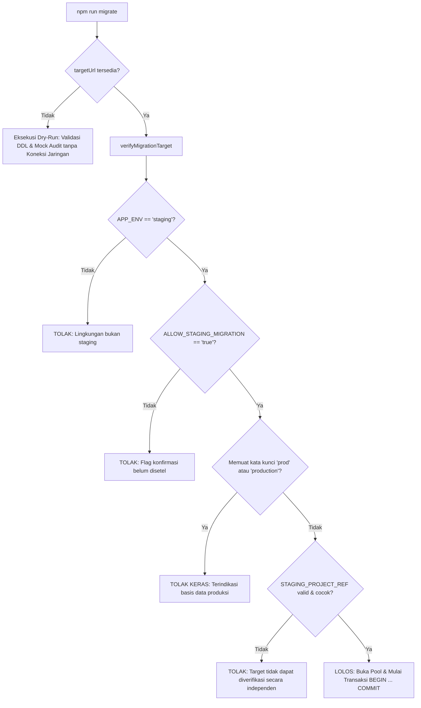

# SIMSARPRAS — LAPORAN PERBAIKAN BLOCKER KEAMANAN (FASE 2G-1)
## Remediasi RLS & Guardrail Runner Migrasi Anti-Produksi

**Versi Dokumen:** 2.1.0-SECURITY-REMEDIATION  
**Tanggal Pelaksanaan:** 13 Oktober 2026  
**Status Evaluasi:** REMEDIATION & VERIFICATION COMPLETED (Tanpa migrasi live, tanpa koneksi live database)  
**Rekomendasi Akhir:** **`READY FOR HUMAN APPROVAL`**  
*(Seluruh blocker kode RLS dan guardrail runner telah ditutup dan lulus pengujian lokal. Sistem siap ditinjau oleh pengguna untuk langkah provisioning dan izin eksekusi staging)*

---

## 1. Perbandingan Temuan: Sebelum vs Sesudah Perbaikan

| Komponen / Parameter | Kondisi Sebelum (Fase 2G) | Kondisi Sesudah (Fase 2G-1) | Status Resolusi |
|---|---|---|:---:|
| **RLS Tabel `users`** | RLS tidak aktif. Kolom sensitif (`password_hash`, `email`) berisiko terbaca publik via PostgREST Supabase. | RLS aktif (`ENABLE ROW LEVEL SECURITY`). Akses dibatasi ketat hanya `TO service_role`. Izin publik dicabut via `REVOKE`. | **RESOLVED (PASS)** |
| **RLS Tabel Master (`categories`, `locations`, `funding_sources`)** | RLS tidak aktif. Akses terbuka bagi role publik bawaan schema. | RLS aktif pada seluruh tabel master. Akses mutasi dan baca dibatasi khusus `TO service_role`. Hak publik dicabut via `REVOKE`. | **RESOLVED (PASS)** |
| **RLS Tabel `assets` & Publik QR** | RLS aktif. Publik diizinkan membaca (`SELECT`), mutasi dibatasi `service_role`. | Dipertahankan dan diperkuat dengan `GRANT SELECT ON TABLE assets TO anon, authenticated`. | **MAINTAINED (PASS)** |
| **Guardrail Lingkungan Migrator** | Runner tidak memiliki pemeriksaan target. Eksekusi dapat berjalan ke database produksi jika kredensial salah dipasang. | Runner menerapkan arsitektur *fail-closed*: wajib `APP_ENV=staging`, `ALLOW_STAGING_MIGRATION=true`, serta verifikasi `STAGING_PROJECT_REF`. | **RESOLVED (PASS)** |
| **Deteksi Anti-Produksi** | Tidak ada deteksi kata kunci atau host produksi. | Menolak keras jika hostname, username, atau path database memuat kata kunci `prod` atau `production`. | **RESOLVED (PASS)** |
| **Pencegahan Kebocoran Kredensial** | Error query berpotensi mengekspos connection string. | Fungsi `sanitizeConnectionUrl` menyamarkan user dan membuang password dari seluruh error/log. | **RESOLVED (PASS)** |
| **Penanganan Error Rollback** | Rollback berpotensi melempar unhandled rejection jika koneksi terputus (*severed connection*). | Query `ROLLBACK` di dalam `catch` dibungkus sub-try-catch aman. | **RESOLVED (PASS)** |

---

## 2. Berkas & Bagian Kode yang Diubah

### A. [`server/db/schema.sql`](file:///c:/Users/Lenovo/Documents/SIMSARPRAS/server/db/schema.sql)
- **Baris 218–235:** Menambahkan pembuatan peran NOLOGIN cadangan (`anon`, `authenticated`, `service_role`) untuk kompatibilitas pengujian PostgreSQL lokal mandiri.
- **Baris 236–246:** Mengaktifkan RLS pada seluruh 8 tabel sistem:
  ```sql
  ALTER TABLE assets ENABLE ROW LEVEL SECURITY;
  ALTER TABLE loans ENABLE ROW LEVEL SECURITY;
  ALTER TABLE return_inspections ENABLE ROW LEVEL SECURITY;
  ALTER TABLE audit_logs ENABLE ROW LEVEL SECURITY;
  ALTER TABLE users ENABLE ROW LEVEL SECURITY;
  ALTER TABLE categories ENABLE ROW LEVEL SECURITY;
  ALTER TABLE locations ENABLE ROW LEVEL SECURITY;
  ALTER TABLE funding_sources ENABLE ROW LEVEL SECURITY;
  ```
- **Baris 248–270:** Menerapkan *Defense-in-Depth* dengan `REVOKE ALL` dari `anon`, `authenticated`, `public` pada tabel-tabel sensitif (`users`, `loans`, `return_inspections`, `audit_logs`, `categories`, `locations`, `funding_sources`). Khusus tabel `assets`, diberikan `GRANT SELECT TO anon, authenticated` untuk kebutuhan pemindaian barcode mandiri publik.
- **Baris 272–330:** Menerapkan kebijakan RLS idempoten:
  - `public_read_assets`: Akses baca publik khusus untuk data katalog aset.
  - `service_role_all_*`: Akses penuh mutasi dan baca hanya untuk backend berotentikasi rahasia (`service_role`) pada seluruh 8 tabel.

### B. [`server/scripts/migrate.ts`](file:///c:/Users/Lenovo/Documents/SIMSARPRAS/server/scripts/migrate.ts)
- **Fungsi `sanitizeConnectionUrl(rawUrl)`:** Menghapus password dan menyamarkan username dari string koneksi sebelum dicetak ke terminal atau log error.
- **Fungsi `verifyMigrationTarget(targetUrl, options)`:** Memeriksa target migrasi secara *fail-closed*:
  1. Memvalidasi `APP_ENV === 'staging'`.
  2. Memvalidasi `ALLOW_STAGING_MIGRATION === 'true'`.
  3. Memastikan URL menggunakan skema `postgres:` atau `postgresql:`.
  4. Mendeteksi dan menolak kata kunci `prod` / `production`.
  5. Memverifikasi bahwa hostname atau username memuat `STAGING_PROJECT_REF` yang diotorisasi secara independen.
- **Fungsi `runMigration()`:**
  - Mode dry-run tetap aman tanpa membuka koneksi (`status: 'DRY_RUN_PASSED'`).
  - Memanggil `verifyMigrationTarget()` sebelum memanggil `new Pool()` atau `pool.connect()`.
  - Membungkus query `ROLLBACK` dalam sub-try-catch agar tidak menyebabkan kegagalan unhandled rejection jika koneksi terputus di tengah jalan.

### C. [`server/.env.example`](file:///c:/Users/Lenovo/Documents/SIMSARPRAS/server/.env.example)
- Menambahkan dokumentasi variabel guardrail:
  ```env
  APP_ENV=staging
  ALLOW_STAGING_MIGRATION=true
  STAGING_PROJECT_REF="[PROJECT_REF_STAGING_SUPABASE]"
  ```

### D. [`src/test/databaseMigration.test.ts`](file:///c:/Users/Lenovo/Documents/SIMSARPRAS/src/test/databaseMigration.test.ts)
- Memperbarui tes keberadaan RLS untuk memverifikasi 8 tabel dan isolasi `users`.
- Menambahkan suite pengujian unit untuk seluruh 8 kasus guardrail keselamatan migrator.

---

## 3. Matriks Kebijakan Akses Tiap Tabel (RLS & Grants)

| Nama Tabel | Status RLS | Akses Publik (`anon`, `authenticated`) | Akses Backend (`service_role`) | Alasan Desain Akses |
|---|:---:|:---:|:---:|---|
| **`assets`** | **ENABLED** | `SELECT` (Read-Only) | `ALL` (Read & Write) | Publik membaca detail barang saat scan QR; mutasi hanya oleh admin sarpras via backend. |
| **`users`** | **ENABLED** | **DENIED (0 Hak Akses)** | `ALL` (Read & Write) | Data kredensial dan `password_hash` diisolasi 100% dari eksposur API PostgREST. |
| **`loans`** | **ENABLED** | **DENIED (0 Hak Akses)** | `ALL` (Read & Write) | Transaksi peminjaman diproses melalui API Express dengan validasi bisnis, bukan direct Supabase. |
| **`return_inspections`** | **ENABLED** | **DENIED (0 Hak Akses)** | `ALL` (Read & Write) | Hasil inspeksi fisik hanya diinput oleh petugas sarpras melalui backend. |
| **`audit_logs`** | **ENABLED** | **DENIED (0 Hak Akses)** | `ALL` (Read & Write) | Log audit bersifat *immutable* dan hanya ditulis oleh backend sistem. |
| **`categories`** | **ENABLED** | **DENIED (0 Hak Akses)** | `ALL` (Read & Write) | Snapshot nama kategori sudah denormalisasi pada `assets`; tidak ada kebutuhan publik baca langsung. |
| **`locations`** | **ENABLED** | **DENIED (0 Hak Akses)** | `ALL` (Read & Write) | Snapshot nama lokasi sudah denormalisasi pada `assets`; tidak ada kebutuhan publik baca langsung. |
| **`funding_sources`** | **ENABLED** | **DENIED (0 Hak Akses)** | `ALL` (Read & Write) | Sumber dana bersifat internal dan dikelola melalui admin backend. |

---

## 4. Mekanisme Guardrail Verifikasi Target Migrator

Runner migrasi ([`server/scripts/migrate.ts`](file:///c:/Users/Lenovo/Documents/SIMSARPRAS/server/scripts/migrate.ts)) mengeksekusi tahapan validasi berikut **sebelum soket TCP dibuka**:



### Karakteristik Perlindungan:
1. **Fail-Closed:** Jika konfigurasi tidak lengkap atau meragukan, proses dihentikan seketika.
2. **Independensi Target:** Memeriksa kesesuaian URL database dengan `STAGING_PROJECT_REF`, sehingga tidak dapat dikelabui hanya dengan mengubah `APP_ENV=staging` pada koneksi produksi.
3. **Nol Kredensial di Log:** String rahasia disanitasi sebelum ditampilkan dalam pesan error atau penolakan.

---

## 5. Hasil Pengujian Aktual (Lokal & Terisolasi)

| Perintah Pengujian | Target Cakupan | Hasil Aktual | Keterangan |
|---|---|:---:|---|
| `npm test` | Seluruh 5 berkas pengujian Vitest (73 unit tests) | **PASSED (73/73)** | Seluruh 8 tes guardrail baru dan pengujian RLS berhasil lulus. |
| `npm run build` | Kompilasi bundel produksi frontend Vite | **PASSED (0 Error)** | Bundel produksi `dist/` terkompilasi dalam 7.75 detik. |
| `npm run build --prefix server` | Kompilasi TypeScript backend Express | **PASSED (0 Error)** | Backend `server/dist/` terkompilasi bersih tanpa peringatan tipe. |
| `npx tsc --noEmit` | Pemeriksaan tipe TypeScript frontend | **PASSED (0 Error)** | Seluruh tipe antarmuka dan komponen valid. |
| `npm run reconcile --prefix server` | Audit rekonsiliasi data mock | **PASSED (11 Aset)** | 11 token utuh, 0 relasi yatim, konsistensi transaksi 100%. |
| `npm run migrate --prefix server` | Eksekusi runner mode dry-run | **PASSED** | Mengembalikan status `DRY_RUN_PASSED` tanpa membuka koneksi. |

---

## 6. Risiko Tersisa & Pengujian yang Membutuhkan PostgreSQL Staging

Meskipun validasi struktural kode telah tuntas, risiko runtime berikut secara teknis **hanya dapat dibuktikan saat PostgreSQL live staging terhubung**:

1. **Uji Runtime RLS Supabase:**
   - Pembuktian bahwa PostgREST Supabase benar-benar menolak request HTTP dari `anon` key saat mencoba mengakses `GET /rest/v1/users` (ekspektasi: HTTP 401 / 403 atau respon kosong).
2. **Kesesuaian Koneksi SSL Direct vs Pooler:**
   - Verifikasi bahwa handshake TLS port 5432 (Session Mode) berhasil dilakukan dari lingkungan runner lokal ke klaster Supabase di region `ap-southeast-1`.
3. **Uji Idempotensi Migrasi Live (TEST-01):**
   - Menjalankan `npm run migrate` dua kali berturut-turut pada basis data PostgreSQL nyata untuk membuktikan bahwa tidak ada error constraint atau kegagalan DDL.
4. **Uji Stres Konkurensi Peminjaman (TEST-03):**
   - Menguji transaksi paralel menggunakan `SELECT ... FOR UPDATE` pada PostgreSQL nyata untuk membuktikan bahwa 2 request bersamaan pada unit yang sama tidak menghasilkan *double booking*.

---

## 7. Konfirmasi Integritas Data & Identitas Barcode

Kami mengonfirmasi dengan tegas bahwa selama pelaksanaan Fase 2G-1:
- [x] **Zero Touch pada Data Produksi & Live DB:** Tidak ada koneksi yang dibuka ke Supabase maupun database produksi.
- [x] **Zero Touch pada `localStorage`:** Struktur mock dan penyimpanan browser tidak mengalami perubahan.
- [x] **Preservasi Identitas Barcode 100%:** Seluruh 11 `qrToken`, `assetCode`, `permanentId`, dan permalink URL barcode `/b/:tokenOrCode` tidak diubah, tidak dihapus, dan tidak digenerasi ulang.
- [x] **Working Tree Terjaga:** Tidak ada commit destruktif, reset, atau stash yang dilakukan.

---

## 8. Checklist Pra-Migrasi Terkini

- [x] **Resolusi Blocker 1:** RLS diaktifkan pada 8 tabel, tabel `users` diisolasi ketat ke `service_role`.
- [x] **Resolusi Blocker 2:** Runner migrasi dipersenjatai guardrail *fail-closed* anti-produksi dan sanitasi URL.
- [x] **Pengujian Otomatis Struktur:** 73/73 unit test lolos.
- [ ] **Provisioning Proyek Supabase:** Pembuatan proyek `simsarpras-staging` di dashboard Supabase oleh pengguna.
- [ ] **Konfigurasi `server/.env`:** Pengisian `DIRECT_URL`, `DATABASE_URL`, `APP_ENV=staging`, `ALLOW_STAGING_MIGRATION=true`, dan `STAGING_PROJECT_REF`.
- [ ] **Persetujuan Terpisah dari Pengguna:** Izin eksplisit untuk mengeksekusi migrasi DDL pada staging.

---

## 9. Rekomendasi Akhir

### Status: **`READY FOR HUMAN APPROVAL`**

### Alasan:
Seluruh blocker keamanan kode pada skema database ([`server/db/schema.sql`](file:///c:/Users/Lenovo/Documents/SIMSARPRAS/server/db/schema.sql)) dan skrip migrator ([`server/scripts/migrate.ts`](file:///c:/Users/Lenovo/Documents/SIMSARPRAS/server/scripts/migrate.ts)) telah **berhasil diperbaiki, diperkuat, dan diverifikasi dengan 73 pengujian otomatis lokal yang lulus 100%**.

Sistem saat ini berada dalam kondisi aman dan siap untuk ditinjau oleh pengguna. Langkah selanjutnya adalah menunggu pengguna membuat proyek database staging di dashboard Supabase dan memberikan izin terpisah untuk pengujian konektivitas live.
