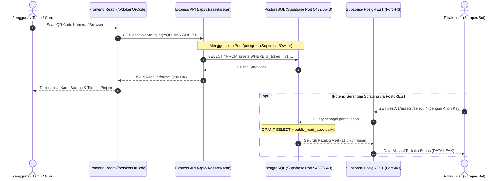

# SIMSARPRAS — REVIEW PENGUATAN AKSES ASET PUBLIK (FASE 2I.3)
## Public Asset Access Hardening Review & Zero-Leakage Architecture

**Versi Dokumen:** 2.1.0-PUBLIC-ASSET-HARDENING-REVIEW  
**Tanggal Pelaksanaan:** 14 Oktober 2026  
**Status Evaluasi:** ARCHITECTURAL SECURITY AUDIT & HARDENING DESIGN (READ-ONLY)  
**Tujuan:** Mengevaluasi rancangan akses publik QR SIMSARPRAS agar pemindaian barcode fisik tetap berfungsi 100% tanpa membuka katalog aset secara massal melalui Supabase PostgREST maupun Express API.

---

## 1. Analisis Alur Data & Kondisi Saat Ini (Current State)

### A. Alur Pemindaian Barcode Publik Saat Ini
Ketika pengguna memindai QR code fisik (misalnya URL: `https://simsarpras.sch.id/b/QR-TIK-ASUS-001` atau `https://simsarpras.sch.id/b/INV-TIK-2024-001`):



### B. Bukti Temuan Kode Sumber
1. **Pada Basis Data ([`server/db/schema.sql`](file:///c:/Users/Lenovo/Documents/SIMSARPRAS/server/db/schema.sql)):**
   - Baris 255: `GRANT SELECT ON TABLE assets TO anon, authenticated;`
   - Baris 271-274:
     ```sql
     CREATE POLICY public_read_assets ON assets
     FOR SELECT
     TO anon, authenticated
     USING (true);
     ```
   - *Temuan:* Hak ini membuka tabel `assets` secara publik melalui PostgREST HTTP endpoint Supabase bagi siapa saja yang memiliki `anon` key (yang merupakan kunci publik di sisi browser).
2. **Pada Frontend ([`src/services/api.ts`](file:///c:/Users/Lenovo/Documents/SIMSARPRAS/src/services/api.ts) & [`src/pages/PublicScanLoan.tsx`](file:///c:/Users/Lenovo/Documents/SIMSARPRAS/src/pages/PublicScanLoan.tsx)):**
   - Frontend **TIDAK PERNAH** memanggil Supabase PostgREST secara langsung. Pustaka `@supabase/supabase-js` bahkan tidak terdaftar dalam `package.json`.
   - Pemindaian barcode memanggil `api.getAssetByCodeOrQr()` ([`src/services/api.ts:L159`](file:///c:/Users/Lenovo/Documents/SIMSARPRAS/src/services/api.ts#L159)) yang melakukan `fetch(`${API_BASE_URL}/assets/scan?query=${encodeURIComponent(codeOrQr)}`)`.
3. **Pada Backend Express ([`server/src/routes/assets.ts`](file:///c:/Users/Lenovo/Documents/SIMSARPRAS/server/src/routes/assets.ts)):**
   - **Listing Seluruh Aset (`GET /api/v1/assets`):** Baris 147-185 mengeksekusi `SELECT * FROM assets WHERE is_decommissioned = false` **tanpa middleware `requireAuth`**. Siapa pun dapat mengunduh seluruh katalog aset langsung melalui Express API.
   - **Lookup Barcode (`GET /api/v1/assets/scan`):** Baris 81-87 memilih seluruh kolom aset tanpa rate limiter per-IP.
   - **Koneksi Database Backend ([`server/src/db.ts`](file:///c:/Users/Lenovo/Documents/SIMSARPRAS/server/src/db.ts#L9)):** Backend terhubung sebagai user `postgres` (database owner), sehingga akses Express sama sekali tidak bergantung pada izin peran `anon` pada RLS database.

---

## 2. Identifikasi Data yang Terekspos ke Publik

| Kanal Akses | Data yang Terekspos | Risiko Keamanan / Privasi | Tingkat Risiko |
|---|---|---|:---:|
| **Supabase PostgREST API** (`/rest/v1/assets`) | Seluruh baris tabel `assets` (11 unit aset atau ribuan di masa depan), seluruh field termasuk `notes`, `funding_source`, `acquisition_year`, `qr_token`, `asset_code`, `permanent_id`. | **Mass Scraping / Catalog Enumeration:** Penyerang dapat mengunduh database inventaris secara penuh tanpa pernah memindai barcode fisik. | **TINGGI (HIGH)** |
| **Express Listing API** (`GET /assets`) | Seluruh daftar aset aktif (nama, kode, brand, lokasi, status operasional, aksesoris, catatan). | **Unauthenticated Bulk Dump:** Tidak dilindungi JWT, memungkinkan bot mengekstraksi seluruh daftar barang sekolah. | **TINGGI (HIGH)** |
| **Express Scan API** (`GET /assets/scan?query=...`) | 1 baris aset yang cocok dengan kode/token: `itemName`, `assetCode`, `locationName`, `conditionStatus`, `operationalStatus`, `photoUrl`, `notes`, `fundingSource`. | **Sequential Code Enumeration:** Penyerang dapat membuat skrip loop `INV-TIK-2024-001` s/d `999` karena ketiadaan rate limiter. Kolom `notes` berisiko memuat catatan internal. | **SEDANG (MEDIUM)** |

---

## 3. Analisis Penghapusan `GRANT SELECT` pada Tabel `assets`

### Pertanyaan Kunci:
> *Dapatkah `GRANT SELECT ON TABLE assets TO anon, authenticated;` dihilangkan tanpa merusak rute QR publik `/b/:tokenOrCode`?*

### Kesimpulan Analisis:
**BISA, 100% AMAN DAN TIDAK MERUSAK FITUR PEMINDAIAN BARCODE!**

### Pembuktian Teknis:
1. **Independensi Koneksi Express:**
   Express backend terhubung ke PostgreSQL menggunakan connection string `DATABASE_URL` ([`server/src/db.ts`](file:///c:/Users/Lenovo/Documents/SIMSARPRAS/server/src/db.ts)). Kredensial ini masuk ke PostgreSQL sebagai peran **`postgres`** (pemilik basis data / *superuser*).
2. **PostgreSQL Privilege Model:**
   Sebagai pemilik tabel (`table owner`), peran `postgres` memiliki hak penuh atas tabel `assets` secara bawaan (*implicit ownership privilege*).
3. **Pencabutan dari `anon`:**
   Jika perintah berikut diterapkan:
   ```sql
   REVOKE ALL ON TABLE assets FROM anon, authenticated, public;
   DROP POLICY IF EXISTS public_read_assets ON assets;
   ```
   - **Akses Langsung via PostgREST:** Permintaan anonim ke Supabase REST API (`/rest/v1/assets`) akan langsung ditolak dengan HTTP 403 / 0 baris (*zero public exposure*).
   - **Akses via Express Backend:** Express backend tetap dapat membaca dan memutasi tabel `assets` secara normal melalui `pool.query()`.
   - **Rute Frontend `/b/:tokenOrCode`:** Browser memanggil Express API `GET /assets/scan?query=...`. Karena Express tetap dapat membaca database, respon data aset tetap diterima oleh browser dengan status 200 OK.

---

## 4. Evaluasi Rancangan Endpoint Publik & Masking Field Aset

### A. Kebutuhan Field Aktual UI Pemindaian Mandiri ([`PublicScanLoan.tsx`](file:///c:/Users/Lenovo/Documents/SIMSARPRAS/src/pages/PublicScanLoan.tsx))
Pemeriksaan kode JSX membuktikan bahwa antarmuka scan publik hanya memerlukan field-field berikut:
- **Identitas Aset:** `id` (untuk payload mutasi pinjam), `assetCode`, `itemName`, `institution`.
- **Lokasi & Spesifikasi:** `locationName`, `itemBrand`, `technicalSpecs`, `standardAccessories`, `photoUrl`.
- **Status Operasional:** `effectiveLoanMode` ('DIRECT' / 'ADMIN_APPROVAL'), `conditionStatus`, `operationalStatus`, `isDecommissioned`.

### B. Field yang Sebaiknya Dikecualikan / Disanitasi untuk Publik
1. **`notes` (Catatan Internal Sarpras):**
   Saat ini kolom `notes` (misal: *"Baterai sehat 98%, tas laptop lengkap"* atau catatan lokasi kunci lemari) dikembalikan secara mentah ke publik. Catatan internal berisiko memuat data sensitif staf atau catatan pemeliharaan yang tidak layak dikonsumsi umum.
2. **`funding_source` (Sumber Pendanaan):**
   Informasi asal dana (misal: "Komite Sekolah", "DAK Fisik") tidak esensial untuk guru yang meminjam barang dan dapat disembunyikan dari endpoint scan publik.

### C. Rancangan Whitelisting Respon Publik (Public Asset DTO)
```typescript
export interface PublicAssetScanResponse {
  id: string;
  assetCode: string;
  itemName: string;
  institution: string;
  categoryName: string;
  locationName: string;
  itemBrand?: string;
  effectiveLoanMode: 'DIRECT' | 'ADMIN_APPROVAL';
  conditionStatus: string;
  operationalStatus: string;
  photoUrl?: string;
  technicalSpecs?: string;
  standardAccessories: string[];
  isDecommissioned: boolean;
  decommissionedAt?: string;
  decommissionedReason?: string;
}
```

---

## 5. Autentikasi, Rate Limiting, Validasi Parameter, & Anti-Enumerasi

### A. Pengamanan Endpoint Listing (`GET /api/v1/assets`)
- **Masalah:** Saat ini endpoint `GET /assets` terbuka tanpa login.
- **Rancangan Penguatan:**
  Pasang middleware `requireAuth` ([`server/src/middleware/auth.ts`](file:///c:/Users/Lenovo/Documents/SIMSARPRAS/server/src/middleware/auth.ts)) pada `assetsRouter.get('/')`.
  Hanya pengguna dengan token otorisasi Bearer JWT yang sah (petugas sarpras/guru yang telah login) yang dapat memuat seluruh inventaris.

### B. Mitigasi Enumerasi pada Endpoint Scan (`GET /api/v1/assets/scan`)
- **Masalah:** Kode aset seperti `INV-TIK-2024-001` mudah ditebak secara berurutan (*sequential enumeration attack*). Ketiadaan rate limiter memungkinkan scraper memindai ratusan kode per detik.
- **Rancangan Penguatan:**
  1. Pasang `scanRateLimiter` menggunakan `createRateLimiter` yang sudah ada pada [`server/src/middleware/rateLimiter.ts`](file:///c:/Users/Lenovo/Documents/SIMSARPRAS/server/src/middleware/rateLimiter.ts):
     - Batas: **30 sampai 60 permintaan per menit per alamat IP**.
     - Pemindaian barcode oleh manusia normal tidak pernah melebihi 10-15 scan per menit.
     - Jika melebihi batas, kembalikan HTTP 429 Too Many Requests dengan header `Retry-After`.
  2. Pertahankan `tokenParamSchema` ([`server/src/validators.ts:L11-L19`](file:///c:/Users/Lenovo/Documents/SIMSARPRAS/server/src/validators.ts#L11-L19)) yang membatasi panjang 2-100 karakter dan regex `/^[A-Za-z0-9_\-\.]+$/`.

---

## 6. Jaminan Kompatibilitas Barcode Fisik & Rute `/b/:tokenOrCode`

Rancangan penguatan ini menjamin **100% Backward Compatibility**:
1. **Barcode Fisik yang Telah Dicetak:**
   - Seluruh barcode fisik menggunakan token `qrToken` (contoh: `QR-TIK-ASUS-001`) atau kode inventaris `assetCode` (contoh: `INV-TIK-2024-001`).
   - Query pencarian database pada Express tetap menggunakan klausul:
     `WHERE qr_token = $1 OR permanent_id = $1 OR asset_code = $1 OR id = $1`
   - Nilai token, kode barang, dan permanent ID **TIDAK DIUBAH SAMA SEKALI**.
2. **Rute Frontend `/b/:tokenOrCode`:**
   - Parameter URL (`tokenOrCode`) tetap diteruskan tanpa modifikasi ke endpoint `/assets/scan?query=...`.
   - Tidak ada perubahan kontrak respons JSON yang dapat merusak parsing frontend. Field legacy `asset` dalam respons tetap dipertahankan untuk kompatibilitas.

---

## 7. Rencana Perubahan Minimal (Target Implementation Plan)

Berikut adalah ringkasan perubahan minimal yang disiapkan untuk diaplikasikan setelah persetujuan:

### 1. Perubahan Skema SQL ([`server/db/schema.sql`](file:///c:/Users/Lenovo/Documents/SIMSARPRAS/server/db/schema.sql))
```diff
--- a/server/db/schema.sql
+++ b/server/db/schema.sql
@@ -250,9 +250,7 @@ REVOKE ALL ON TABLE categories FROM anon, authenticated, public;
 REVOKE ALL ON TABLE locations FROM anon, authenticated, public;
 REVOKE ALL ON TABLE funding_sources FROM anon, authenticated, public;
+REVOKE ALL ON TABLE assets FROM anon, authenticated, public;
 
--- Khusus tabel assets: izinkan peran publik (anon, authenticated) membaca (SELECT) untuk scan QR mandiri
-GRANT SELECT ON TABLE assets TO anon, authenticated;
-
 -- Memberikan hak akses penuh kepada service_role (backend Express berwenang)
@@ -268,14 +266,5 @@ GRANT ALL ON TABLE audit_logs TO service_role;
-
--- 8.3. KEBIJAKAN AKSES PUBLIK (HANYA UNTUK ASET)
--- Kebijakan 1: Publik (anon & authenticated) hanya dapat membaca aset (SELECT) untuk keperluan scan QR mandiri
-DO $$ BEGIN
-    IF NOT EXISTS (SELECT 1 FROM pg_policies WHERE policyname = 'public_read_assets') THEN
-        CREATE POLICY public_read_assets ON assets
-        FOR SELECT
-        TO anon, authenticated
-        USING (true);
-    END IF;
-END $$;
```

### 2. Perubahan Rute Express ([`server/src/routes/assets.ts`](file:///c:/Users/Lenovo/Documents/SIMSARPRAS/server/src/routes/assets.ts))
1. Pasang `requireAuth` pada `assetsRouter.get('/')` (listing massal).
2. Pasang `createRateLimiter({ windowMs: 60 * 1000, max: 60 })` pada rute scan publik.

---

## 8. Rencana Pengujian Validasi (Test Plan)

Setelah perubahan minimal diterapkan di fase berikutnya, verifikasi dilakukan melalui:
1. **Uji Penolakan PostgREST:** Query curl ke Supabase REST API dengan anon key memastikan respon 401/403 (bukan 200).
2. **Uji Rute Scan Publik:** Query curl ke `http://localhost:10000/api/v1/assets/scan?query=QR-TIK-ASUS-001` tanpa token memastikan respon 200 OK dengan detail aset.
3. **Uji Proteksi Listing:** Query curl ke `http://localhost:10000/api/v1/assets` tanpa token memastikan respon 401 Unauthorized.
4. **Uji Rate Limiting:** Pengiriman 65 request berturut-turut memastikan request ke-61 menerima 429 Too Many Requests.
5. **Uji Regresi UI Frontend:** Menjalankan 17 pengujian unit pada `src/test/qrIdentityAndUrl.test.tsx` memastikan seluruh rute `/b/:tokenOrCode` tetap hijau (PASS).

---

> [!IMPORTANT]
> **Status Tindakan Saat Ini:**
> Antigravity **BERHENTI** di sini sesuai instruksi keselamatan Fase 2I.3.
> Tidak ada perubahan kode, tidak ada mutasi basis data, dan tidak ada migrasi yang dijalankan pada fase ini.
> Dokumen ini merupakan rancangan dan kajian keselamatan untuk ditinjau oleh manusia sebelum melangkah ke implementasi atau Fase 2J.
