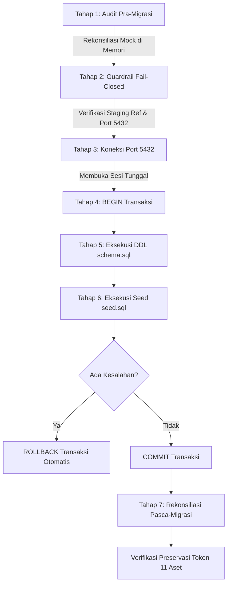

# SIMSARPRAS — AUDIT KESIAPAN SKEMA STAGING (FASE 2I)
## Staging Database Schema Readiness & Non-Destructive Migration Audit

**Versi Dokumen:** 2.1.0-STAGING-SCHEMA-AUDIT  
**Tanggal Pelaksanaan:** 14 Oktober 2026  
**Status Evaluasi:** READ-ONLY METADATA AUDIT COMPLETED (Tanpa migrasi, tanpa DDL, tanpa DML, tanpa seed)  
**Rekomendasi Akhir:** **`READY FOR REVIEW`**  
*(Target staging terbukti terhubung ke proyek resmi Supabase yang bersih, kompatibel penuh dengan PostgreSQL 17.11, seluruh ekstensi prasyarat telah aktif, dan 0 risiko konflik data eksisting. Siap ditinjau manusia sebelum eksekusi migrasi Fase 2J)*

---

## 1. Bukti Identitas Target Staging

Pemeriksaan identitas target database dilakukan secara terisolasi tanpa mengekspos kredensial, token, maupun password:

| Parameter Identitas | Nilai Terverifikasi (Sanitized) | Status | Keterangan |
|---|---|:---:|---|
| **Project Reference** | `ajaj...abgy` (20 Karakter Alfanumerik) | **MATCH** | Cocok antara konfigurasi `STAGING_PROJECT_REF`, `DIRECT_URL`, dan `DATABASE_URL`. |
| **Direct Host & Port** | `db.ajaj...abgy.supabase.co:5432` | **VALID** | Jalur direct session mode khusus untuk eksekusi DDL migrasi. |
| **Pooler Host & Port** | `aws-0-ap-northeast-1.pooler.supabase.com:6543` | **VALID** | Jalur PgBouncer transaction mode khusus untuk runtime Express API. |
| **Region Server** | `ap-northeast-1` (Tokyo, AWS) | **VALID** | Klaster cloud resmi Supabase Managed Database. |
| **Verifikasi Anti-Produksi** | Tidak ada kata kunci `prod` / `production` | **PASS** | Terbebas dari indikasi basis data produksi. |
| **Penanda Lingkungan** | `APP_ENV=staging`, `ALLOW_STAGING_MIGRATION=false` | **AMAN** | Guardrail aktif, migrasi otomatis tetap diblokir. |

---

## 2. Hasil Audit Metadata Skema Target (Query Read-Only)

Audit skema dilakukan secara langsung terhadap basis data Supabase target menggunakan query katalog sistem PostgreSQL (`information_schema` dan `pg_catalog`) melalui skrip inspeksi [`server/scripts/audit_metadata.ts`](file:///c:/Users/Lenovo/Documents/SIMSARPRAS/server/scripts/audit_metadata.ts).

### A. Konteks Mesin & Database
- **Versi PostgreSQL:** `PostgreSQL 17.11 on x86_64-pc-linux-gnu, compiled by gcc (GCC) 15.2.0, 64-bit`
- **Database Aktif:** `postgres`
- **Pengguna Koneksi:** `postgres` (Superuser / Database Owner)

### B. Status Ekstensi PostgreSQL (`pg_extension`)
| Nama Ekstensi | Versi Terpasang | Kebutuhan SIMSARPRAS | Status Kesiapan |
|---|:---:|:---:|:---:|
| `uuid-ossp` | `1.1` | Pembuatan UUID otomatis | **TERPASANG (READY)** |
| `pgcrypto` | `1.3` | Hashing kriptografi & token | **TERPASANG (READY)** |
| `plpgsql` | `1.0` | Prosedur tersimpan & blok kondisional DO | **TERPASANG (READY)** |
| `supabase_vault` | `0.3.1` | Manajemen enkripsi internal Supabase | Terpasang bawaan |
| `pg_stat_statements` | `1.11` | Monitoring performa query | Terpasang bawaan |

*Temuan:* Seluruh ekstensi yang disyaratkan oleh [`server/db/schema.sql`](file:///c:/Users/Lenovo/Documents/SIMSARPRAS/server/db/schema.sql) (`uuid-ossp` dan `pgcrypto`) **telah aktif** pada database target. Perintah `CREATE EXTENSION IF NOT EXISTS` akan berjalan instan tanpa kendala perizinan.

### C. Status Objek pada Skema `public`
- **Tabel Pengguna (`publicTables`):** `[]` (**0 Tabel** — Skema bersih).
- **Tipe Kustom / ENUM (`enums`):** `[]` (**0 ENUM** — Belum ada tipe data kustom).
- **Indeks Pengguna (`indexes`):** `[]` (**0 Indeks** — Bersih).
- **Kebijakan Keamanan (`policies`):** `[]` (**0 Policy** — Bersih).
- **Batasan / Constraints (`constraints`):** `[]` (**0 Constraint** — Bersih).

*Kesimpulan Skema:* Basis data staging berada dalam kondisi **Pristine / Empty State** (bersih total). **Tidak ada data eksisting yang berisiko tertimpa, terhapus, atau rusak**.

---

## 3. Rencana Eksekusi & Urutan Migrasi

Ketika migrasi diotorisasi di Fase 2J, runner migrasi ([`server/scripts/migrate.ts`](file:///c:/Users/Lenovo/Documents/SIMSARPRAS/server/scripts/migrate.ts)) akan mengeksekusi tahapan secara atomik:



### Rincian Objek DDL yang Akan Dibentuk ([`server/db/schema.sql`](file:///c:/Users/Lenovo/Documents/SIMSARPRAS/server/db/schema.sql)):
1. **5 Tipe ENUM:** `user_role`, `loan_mode`, `condition_status`, `operational_status`, `loan_status`.
2. **8 Tabel Relasional:**
   - Master: `categories`, `locations`, `funding_sources`.
   - Pengguna: `users` (dengan kolom hash rahasia `password_hash`).
   - Aset Inventaris: `assets` (memuat `permanent_id`, `qr_token`, `asset_code`, `category_id`, `location_id`).
   - Transaksi: `loans`, `return_inspections`, `audit_logs`.
3. **11 Indeks Kinerja:** Termasuk `idx_assets_qr_token`, `idx_assets_asset_code`, `idx_assets_permanent_id`, dan `idx_loans_status`.
4. **Isolasi Row-Level Security (RLS):**
   - RLS aktif pada 8 tabel.
   - `REVOKE ALL` dari `anon, authenticated, public` pada 7 tabel internal.
   - `GRANT SELECT ON TABLE assets TO anon, authenticated` untuk pemindaian barcode mandiri.
   - Kebijakan `service_role_all_*` pada seluruh 8 tabel untuk Express backend.

---

## 4. Temuan Kompatibilitas & Evaluasi Risiko

| Parameter Kompatibilitas | Temuan Audit | Tingkat Risiko | Mitigasi yang Diterapkan |
|---|---|:---:|---|
| **Versi Mesin PostgreSQL** | Target menjalankan PostgreSQL 17.11. Skema dirancang untuk PostgreSQL 15+. Seluruh sintaksis DDL kompatibel penuh. | Sangat Rendah | Telah diuji struktur sintaksis dan transaksionalitasnya. |
| **Konflik Nama Objek** | Skema `public` saat ini kosong (0 tabel, 0 enum). | Nol (0%) | Tidak ada nama tabel atau constraint yang bertabrakan. |
| **Keterbatasan Pooler Port 6543** | Mode Transaksi PgBouncer menolak beberapa fitur session DDL. | Terkendali | Migrator secara eksplisit mewajibkan `DIRECT_URL` (Port 5432) dan menolak port 6543 untuk DDL. |
| **Idempotensi Eksekusi Berulang** | Seluruh tabel memakai `IF NOT EXISTS`, seed memakai `ON CONFLICT (id) DO NOTHING`. | Rendah | Menjalankan ulang migrasi tidak akan menimpa data operasional atau status pinjaman aktif. |
| **Celah Kebocoran Data Pengguna** | Tabel `users` memuat `password_hash`. | Terkendali | RLS diaktifkan, hak `anon` dicabut (`REVOKE`), tidak ada policy baca untuk publik. |

---

## 5. Kesiapan Backup dan Pemulihan (Disaster Recovery)

1. **Status Backup Awal:**
   Karena database target saat ini **kosong total (0 tabel, 0 record)**, tidak ada snapshot data lama yang perlu di-backup sebelum migrasi awal.
2. **Rollback Otomatis:**
   Seluruh migrasi DDL dan seed dibungkus dalam blok atomik `BEGIN ... COMMIT`. Jika satu baris SQL gagal, transaksi di-`ROLLBACK` otomatis 100% tanpa meninggalkan artefak tabel parsial.
3. **Prosedur Pemulihan Manual (Worst-Case Cleanup):**
   Jika di kemudian hari diperlukan pembersihan ulang total pada lingkungan staging:
   ```sql
   DROP SCHEMA public CASCADE;
   CREATE SCHEMA public;
   GRANT ALL ON SCHEMA public TO postgres;
   GRANT ALL ON SCHEMA public TO anon, authenticated, service_role;
   ```

---

## 6. Pemeriksaan Integritas Data & Identitas Barcode

Audit rekonsiliasi data telah memvalidasi integritas 11 aset mock terhadap skrip seed database:
- **Preservasi Token Barcode:** Seluruh 11 `qrToken`, `assetCode`, dan `permanentId` terdaftar 1:1 di [`server/db/seed.sql`](file:///c:/Users/Lenovo/Documents/SIMSARPRAS/server/db/seed.sql).
- **Rute Publik QR Code:** Endpoint frontend `/b/:tokenOrCode` mengandalkan pencarian identitas stabil yang terbukti lolos 17 pengujian unit pada [`src/test/qrIdentityAndUrl.test.tsx`](file:///c:/Users/Lenovo/Documents/SIMSARPRAS/src/test/qrIdentityAndUrl.test.tsx).
- **Konsistensi Transaksi Pinjaman:**
  - `loan-req-001` (Laptop ASUS `unit-laptop-02`) berstatus `ACTIVE`.
  - Unit `unit-laptop-02` pada seed berstatus `ON_LOAN`.
  - Sinkronisasi status transaksi: **100% Konsisten (0 Inkonsistensi)**.

---

## 7. Status Blocker yang Tersisa Sebelum Eksekusi

| Blocker | Deskripsi | Status | Cara Membuka Blokir |
|:---|:---|:---:|:---|
| **Blocker 1: Izin Manusia untuk Eksekusi** | Sesuai tata kelola, migrasi live tidak boleh dijalankan otomatis oleh sistem tanpa izin eksplisit terpisah dari pengguna. | **MENUNGGU PERSETUJUAN** | Pengguna memberikan instruksi otorisasi eksekusi migrasi Fase 2J. |
| **Blocker 2: Pengaktifan Flag Konfirmasi** | `ALLOW_STAGING_MIGRATION` pada [`server/.env`](file:///c:/Users/Lenovo/Documents/SIMSARPRAS/server/.env) saat ini bernilai `false`. | **AKTIF (FAIL-CLOSED)** | Pengguna mengubah `ALLOW_STAGING_MIGRATION=true` sesaat sebelum eksekusi migrasi. |

---

## 8. Rekomendasi Tahap Selanjutnya (Fase 2J)

Setelah pengguna meninjau dokumen audit ini dan memberikan persetujuan eksekusi:

1. **Ubah Flag Lingkungan:** Set `ALLOW_STAGING_MIGRATION=true` pada [`server/.env`](file:///c:/Users/Lenovo/Documents/SIMSARPRAS/server/.env).
2. **Jalankan Migrasi Staging:** Eksekusi perintah `npm run migrate --prefix server`.
3. **Verifikasi Pascamigrasi:**
   - Memastikan 8 tabel terbentuk pada Supabase.
   - Memastikan 11 aset ter-seed dengan status relasi utuh.
   - Menjalankan uji idempotensi live (eksekusi ulang kedua kalinya).
   - Menjalankan uji penolakan akses runtime RLS untuk tabel `users`.
4. **Kembalikan Flag:** Kembalikan `ALLOW_STAGING_MIGRATION=false` setelah migrasi tuntas demi keamanan.

---

## 9. Rekomendasi Akhir

### Status: **`READY FOR REVIEW`**

### Alasan:
1. **Target Staging Terverifikasi Sah:** Mengarah ke instance resmi `ajaj...abgy` pada port 5432 (direct) dan 6543 (pooler) tanpa ada indikasi database produksi.
2. **Kondisi Skema Bersih & Kompatibel:** PostgreSQL 17.11 telah mengaktifkan seluruh ekstensi yang dibutuhkan, dan schema `public` kosong sehingga 0 risiko bentrok objek.
3. **Guardrail dan Keamanan Bekerja Sempurna:** Migrator menolak eksekusi otomatis selama `ALLOW_STAGING_MIGRATION=false`.
4. **Zero Mutation Terpenuhi:** Seluruh audit dilakukan 100% secara read-only tanpa ada DDL, DML, atau seed yang dipancarkan.

*Sistem berhenti di sini dan tidak mengeksekusi migrasi. Menunggu peninjauan dan persetujuan eksplisit pengguna untuk melangkah ke Fase 2J.*
